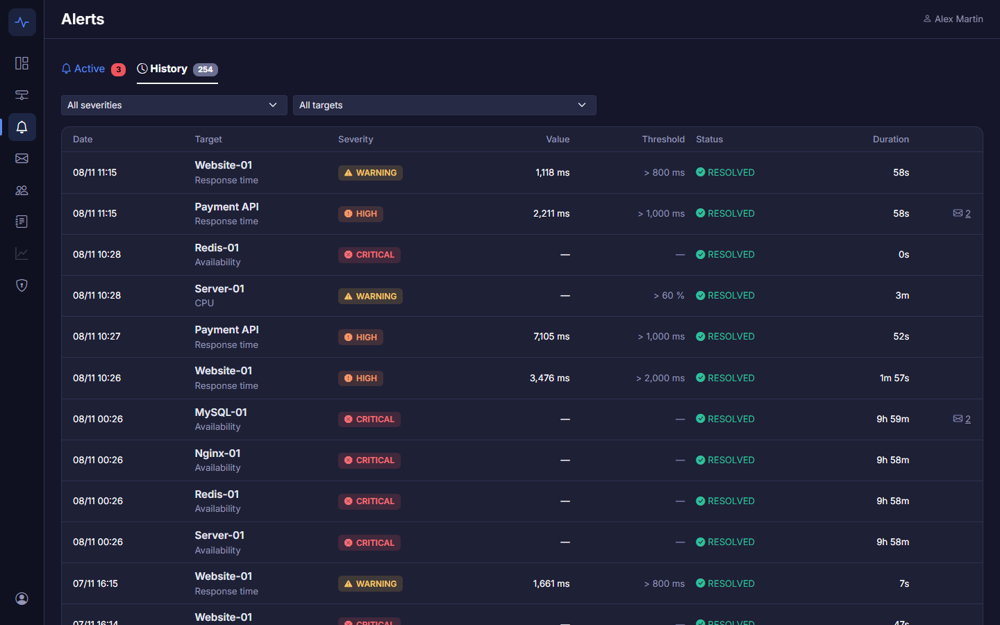
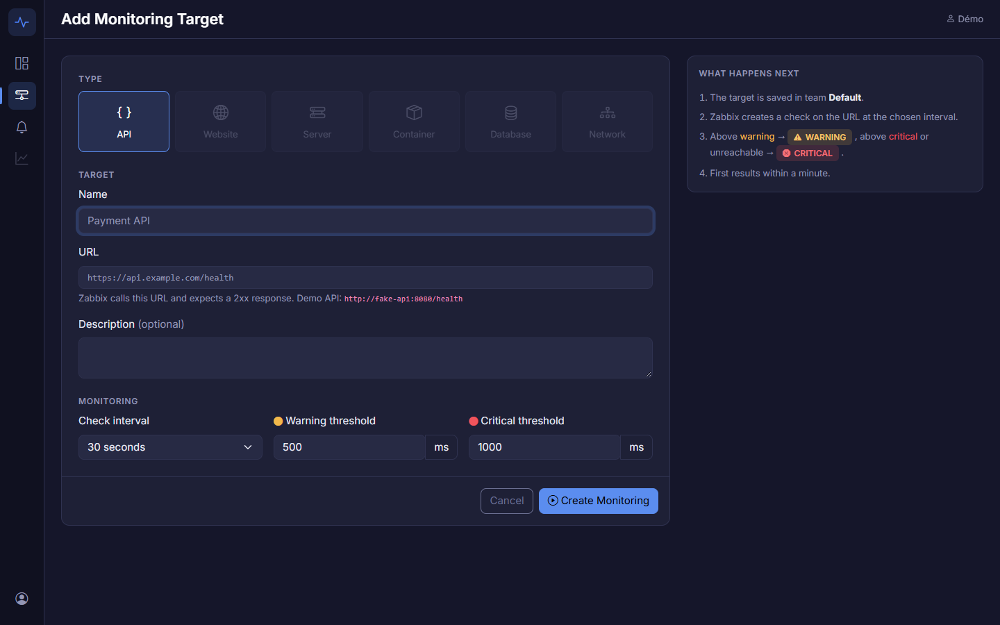

# Monitoring & Alerting Platform

Plateforme web Full-Stack pour déclarer, surveiller et visualiser des ressources informatiques
(APIs, sites web, serveurs, conteneurs, bases de données…).

- **Laravel** : interface (Blade + Bootstrap 5 + Bootstrap Icons), métier, alertes, RBAC
- **Zabbix** : moteur de supervision, piloté uniquement via son API
- **Grafana** : visualisation avancée des métriques (datasource Zabbix)

Cahier des charges : v1.2 · Suivi : Jira, projet `SCRUM`.

## Aperçu

| **Dashboard** | **Page d'une target** |
|---|---|
|  |  |
| **Historique des alertes** | **Ajouter une target** |
|  |  |

Tous les écrans, annotés : [docs/conception/07-ecrans.md](docs/conception/07-ecrans.md).

## Architecture

```
navigateur ──► nginx :8000 ──► app (Laravel, PHP-FPM) ──► mysql (base Laravel)
                                   │                  └─► redis (cache / queues) ◄── queue + scheduler
                                   └── API JSON-RPC ──► zabbix-web :8080 ──► zabbix-server ──► targets
                                                                  │              │           (ex : fake-api)
navigateur ──► grafana :3000 ── datasource Zabbix ────────────────┘              └──► zabbix-agent2 :10050
                                                                                       ├─► docker-socket-proxy ──► Docker (lecture)
                                                                                       └─► mysql (zbx_monitor, lecture)
```

| Service | URL depuis le PC | Rôle |
|---|---|---|
| `nginx` + `app` | http://localhost:8000 | Application Laravel |
| `mysql` | `localhost:3307` | Base Laravel |
| `redis` | — | Cache et queues |
| `queue` + `scheduler` | — | Worker de la queue et Laravel Scheduler : synchro Zabbix chaque minute |
| `zabbix-web` | http://localhost:8080 (`Admin` / `zabbix`) | Interface et API Zabbix |
| `zabbix-server` + `zabbix-db` | — | Moteur Zabbix et sa propre base |
| `zabbix-agent2` | — | Agent Zabbix 2 : serveurs, conteneurs, bases de données ([détails](#agent-zabbix-2)) |
| `docker-socket-proxy` | — | Filtre du socket Docker : l'agent ne peut que lire |
| `mysql-monitor-user` | — | Ponctuel : crée l'utilisateur MySQL `zbx_monitor` de l'agent, puis s'arrête |
| `grafana` | http://localhost:8000/grafana/ (utilisateurs) · http://localhost:3000/grafana/ (`admin` / `GRAFANA_ADMIN_PASSWORD`) | Dashboards |
| `fake-api` | http://localhost:8081/health | API de démo à latence réglable |
| `phpmyadmin` | http://localhost:8082 | phpMyAdmin : interface web des bases MySQL (dev) |
| `mailpit` | http://localhost:8025 | Boîte mail de dev : reset de mot de passe, vérification d'email |

## Installation

Prérequis : Docker Desktop, Node 20+ (pour compiler le front).

```bash
cp .env.example .env               # puis changer les mots de passe
docker compose up -d --build       # 1er démarrage ≈ 5 min (Zabbix crée sa base)

docker compose exec app composer install
docker compose exec app php artisan key:generate
docker compose exec app php artisan migrate
docker compose exec app php artisan platform:create-admin <votre-email>   # premier Super Admin (mot de passe demandé)

npm install
npm run build                      # ou "npm run dev" pendant le développement
```

### Token API Zabbix

Laravel s'authentifie auprès de Zabbix avec un **token API** (jamais avec un mot de passe) :

1. Zabbix (http://localhost:8080) → *Users* › *API tokens* › **Create API token**
   (nom : `laravel-app`, utilisateur : `Admin`, sans date d'expiration en dev)
2. Copier le token dans `.env` → `ZABBIX_API_TOKEN=...`
3. Vérifier : `docker compose exec app php artisan zabbix:check`

Les appels sont journalisés dans `storage/logs/zabbix-<date>.log` (INFO / ERROR, sans token ni paramètres).

### Synchronisation des alertes

Chaque minute, le scheduler place le job `SyncZabbixEvents` dans la queue Redis : il lit les problèmes Zabbix,
crée ou résout les alertes et met à jour le statut des targets (UP / WARNING / CRITICAL / UNKNOWN).

| Zabbix | Plateforme |
|---|---|
| 0 Not classified, 1 Information | INFO |
| 2 Warning, 3 Average | WARNING |
| 4 High | HIGH |
| 5 Disaster | CRITICAL |

Lancer une synchro tout de suite : `docker compose exec app php artisan zabbix:sync`.
Après une modification du code PHP, redémarrer le worker : `docker compose restart queue`.

Sous Windows, `vendor/` du conteneur vit dans un volume Docker (sinon chaque page prend plusieurs secondes).
Après toute modification de `composer.json` : `docker compose exec app composer install`.

Toutes les commandes `artisan` passent par le conteneur : `docker compose exec app php artisan …`
(depuis Windows, les hôtes `mysql`, `redis` et `zabbix-web` n'existent pas).

## Types de targets

| Type | Ce que Zabbix vérifie | Alertes |
|---|---|---|
| **API** | Web scenario `api-check` : code 2xx attendu, temps de réponse, code HTTP | Indisponible (CRITICAL), lenteur (WARNING / HIGH selon les seuils) |
| **Website** | Comme l'API (web scenario `website-check`) + pour une URL `https://`, date d'expiration du certificat SSL lue chaque heure par l'agent Zabbix 2 | Mêmes alertes + certificat qui expire dans moins de 14 jours (WARNING) puis 3 jours (HIGH) ; un certificat expiré déclenche HIGH |

| **Server** | Agent Zabbix installé sur le serveur (adresse + port), template `Linux by Zabbix agent` : CPU, mémoire, disque /, charge, uptime, OS | Indisponible (pas de réponse depuis 3 min, CRITICAL), CPU / mémoire / disque au-dessus des seuils en % (WARNING puis HIGH, moyenne sur 5 min) |

| **Container** | Conteneur Docker lu par l'agent Zabbix 2 de son hôte (plugin Docker, par défaut `zabbix-agent2`) : état, CPU, mémoire, réseau, redémarrages, uptime | Conteneur arrêté ou introuvable (CRITICAL), plus de 2 redémarrages en 10 min (HIGH), mémoire au-dessus du seuil en Mo (WARNING) |

| **Database** | MySQL lu par l'agent Zabbix 2 de la plateforme (plugin MySQL) avec un utilisateur en lecture seule : disponibilité, connexions, requêtes lentes, requêtes/s, version, uptime ; temps de réponse = connexion TCP mesurée par le serveur Zabbix | Base injoignable (CRITICAL), connexions au-dessus du seuil (WARNING) |

Le mot de passe d'une base est **chiffré** en base (clé `APP_KEY`), jamais affiché, jamais journalisé ni renvoyé dans
le formulaire ; Zabbix le reçoit dans une macro secrète. Laissé vide à la modification, il reste inchangé.

Chaque type a ses écrans (SCRUM-72) : le **dashboard** se filtre par catégorie (All, APIs, Websites, Servers,
Containers, Databases), la **liste des targets** affiche les colonnes du type filtré (temps de réponse, CPU, état du
conteneur…), la **page d'une target** ses cartes et ses graphiques (temps de réponse, CPU / mémoire / disque,
connexions…), et le menu **Monitoring** donne accès à chaque type.

Les autres types (réseau) apparaissent grisés dans le formulaire tant qu'ils ne
sont pas disponibles. Même protection SSRF pour tous les types qui appellent une URL.
Pour un serveur, seuls les triggers créés par la plateforme deviennent des alertes : ceux du template Linux restent
visibles dans Zabbix. Serveur de démo : `zabbix-agent2`, port `10050`.

## Équipes, rôles et sécurité

**Super Admin de la plateforme** (DSI, SCRUM-81) : au-dessus des teams. Il est désigné en ligne de commande, jamais
par le web, et n'a aucun droit dans une team dont il n'est pas membre.

```bash
docker compose exec app php artisan platform:create-admin it.admin@company.com   # nouveau compte (mot de passe demandé) ou promotion
docker compose exec app php artisan platform:create-admin demo@example.com       # environnement de démo : promouvoir le compte demo
docker compose exec app php artisan platform:list-admins
docker compose exec app php artisan platform:revoke-admin it.admin@company.com   # refusé pour le dernier Super Admin
docker compose exec app php artisan platform:invite jane@company.com Payments --role=admin   # invitation dans n'importe quelle team
```

**Création des comptes** (SCRUM-82), réglée par `REGISTRATION_MODE` dans `.env` :

| Mode | Inscription |
|---|---|
| `invite` (par défaut) | aucune page d'inscription (404) : on entre seulement sur invitation |
| `domain` | ouverte aux adresses des domaines de `REGISTRATION_DOMAINS` (ex. `company.com,company.fr`) |
| `open` | ouverte à tous, pour une démo publique |

**L'invitation est la porte d'entrée normale** (SCRUM-83), quel que soit le mode. Pour une adresse sans compte, le
lien ouvre « Create your account » : l'email est prérempli et non modifiable, il est considéré comme vérifié, et la
personne arrive directement dans la team avec le rôle choisi. Avec un compte existant, elle se connecte puis rejoint la
team. Le lien est signé, valable 7 jours et ne sert qu'une fois.

Aucune team n'est créée à l'inscription. Un compte sans team voit la page **Waiting for access** (son adresse, et le
contact `REGISTRATION_CONTACT` s'il est défini) jusqu'à ce qu'un Admin de team l'ajoute. Les Super Admin reçoivent un
email dès qu'un nouveau compte a vérifié son adresse.

**Console d'administration** (menu bouclier, `/admin/users`, SCRUM-84) : la liste de tous les comptes (teams et rôles,
Super Admin, statut, dernière connexion, 2FA) avec recherche et filtres, et l'onglet **Invited** des invitations sans
compte. Sur la fiche d'un compte :

- inviter, ajouter à une team, changer de rôle, retirer d'une team ; promouvoir ou retirer Super Admin ;
- **désactiver** au lieu de supprimer : connexion refusée, sessions fermées, accès Grafana retiré, plus aucune
  notification ; teams, historique et audit gardés ; réactivation en un clic ;
- **forcer la réinitialisation du mot de passe** : l'ancien ne marche plus, les sessions sont fermées et l'email
  « mot de passe oublié » est envoyé.

Garde-fous : on ne se désactive pas soi-même, le dernier Super Admin actif reste, et une team garde toujours un Admin
actif.

**Double authentification** (SCRUM-86) : code TOTP d'une application (Google Authenticator, Microsoft Authenticator,
1Password…) après le mot de passe, et 8 codes de secours. Chacun l'active depuis **My account → 2FA**. Elle est
**obligatoire pour les Super Admin et les Admin de team** : sans elle, ils sont renvoyés sur la page d'activation (et
Grafana leur est fermé). Téléphone perdu sans code de secours : un Super Admin la réinitialise depuis la fiche du
compte. `TWO_FACTOR_FOR_ADMINS=false` coupe l'obligation, pour une démo jetable seulement.

**Teams** (`/admin/teams`, SCRUM-85) : les teams sont créées par la DSI, plus à l'inscription. Liste (Admins, membres,
targets, alertes actives) ; création avec le premier Admin (un compte existant est ajouté, une adresse inconnue est
invitée comme Admin), et son host group Zabbix et son organisation Grafana dans la foulée ; renommage (Zabbix et Grafana
suivent) ; suppression en tapant le nom exact : targets retirées de Zabbix, organisation Grafana supprimée, comptes
des membres gardés.

**Audit de la plateforme** (`/admin/audit`) : les entrées de toutes les teams et les actions de plateforme (comptes,
Super Admin, teams supprimées), avec des filtres par team (ou « Platform only »), action, auteur et dates.

Rôles dans une team :

| Rôle | Peut |
|---|---|
| **Viewer** | voir le dashboard, les targets et les alertes |
| **Manager** | + créer, modifier, supprimer des targets et acquitter les alertes |
| **Admin** | + inviter et gérer les membres, consulter le journal d'audit, configurer la team |

- **Membres** (`/teams/{team}/members`) : invitation par email (lien signé valable 7 jours), changement de rôle, retrait ;
  une team garde toujours au moins un Admin.
- **Journal d'audit** (`/teams/{team}/audit`) : qui a fait quoi et quand, filtres par action, membre et période ;
  purgé après 1 an (`audit:purge`).
- **My account** : suppression du compte et des données personnelles (RGPD), audit anonymisé.
- **SSRF** : une target ne peut pas viser une adresse interne (`localhost`, réseau privé…), contrôlé après résolution DNS.
- **En-têtes** : CSP sans script inline, `X-Frame-Options`, `nosniff`, HSTS en HTTPS. Pas de `onclick=` / `onchange=`
  dans les vues : utiliser `data-auto-submit` et `data-confirm`.

Analyse de menaces : [docs/conception/06-menaces-stride-owasp.md](docs/conception/06-menaces-stride-owasp.md).

## Exploitation

| Sujet | Commande | Documentation |
|---|---|---|
| Sauvegardes des 2 bases (chaque nuit à 02:30 UTC, gardées 7 jours) | `php artisan backup:run`, `backup:list`, `backup:restore` | [sauvegardes.md](docs/exploitation/sauvegardes.md) |
| Mise en production (HTTPS, `APP_DEBUG=false`, logs 14 jours) | `docker compose -f docker-compose.yml -f docker-compose.prod.yml up -d`, puis `php artisan security:check` | [production.md](docs/exploitation/production.md) |
| Mises à jour des dépendances et des images | routine mensuelle, `npm audit` et `composer audit` dans la CI | [mises-a-jour.md](docs/exploitation/mises-a-jour.md) |

## Voir les bases de données (phpMyAdmin)

http://localhost:8082. Le port 3307 est un port MySQL : il ne s'ouvre pas dans un navigateur.

| Serveur (liste déroulante) | Utilisateur | Mot de passe |
|---|---|---|
| **Laravel** | `DB_USERNAME` | `DB_PASSWORD` |
| **Zabbix** | `zabbix` | `ZBX_DB_PASSWORD` |

Valeurs dans `.env`. La base Zabbix se consulte en lecture seule : on la modifie toujours par l'API.

## Fausse API de démo

```bash
curl -s "http://localhost:8081/control?delay=1200"      # rend l'API lente (1,2 s)
curl -s "http://localhost:8081/control?mode=error"      # renvoie des erreurs 500
curl -s "http://localhost:8081/control?mode=ok&delay=0" # retour à la normale
```

Vue depuis Zabbix, son adresse est `http://fake-api:8080/health` (nom du service Docker).

## Environnement de démonstration

Une ressource de chaque type, et des pannes à provoquer (SCRUM-73) :

- Server-01, Website-01, MySQL-01, Redis-01 et Nginx-01, en plus de la fausse API ;
- pannes : CPU élevé, disque qui se remplit, site lent, conteneur arrêté, base injoignable.

```bash
docker compose --profile demo up -d                                          # profil "demo" : non lancé par défaut
docker compose exec -u www-data app php artisan db:seed --class=DemoSeeder   # compte demo@example.com, team Demo, 6 targets
```

Commandes des pannes et scénario de démonstration : [`docs/demo/README.md`](docs/demo/README.md).

## Agent Zabbix 2

Les serveurs, conteneurs et bases de données se supervisent avec l'agent Zabbix 2 (service `zabbix-agent2`).
Il fonctionne en **mode passif** : `zabbix-server` l'interroge sur `zabbix-agent2:10050`, seul serveur autorisé.
Aucun port n'est publié sur le PC. La plateforme crée les hosts avec une interface agent vers cette adresse
(`ZABBIX_AGENT_HOST` / `ZABBIX_AGENT_PORT`).

| Plugin | Accès donné à l'agent |
|---|---|
| **Docker** | Le socket Docker passe par `docker-socket-proxy` : seules les lectures utilisées par le plugin sont permises (infos, conteneurs, images, espace disque). Créer, lancer, supprimer un conteneur ou lire ses fichiers est refusé (403 / 405). Un simple montage `docker.sock:ro` ne protège pas : il laisse tout faire. |
| **MySQL** | Utilisateur `zbx_monitor` (mot de passe `ZBX_MONITOR_DB_PASSWORD`), droits du template officiel : `PROCESS`, `REPLICATION CLIENT`, `SHOW DATABASES`, `SHOW VIEW`. Il ne lit aucune donnée. L'agent ne stocke aucun identifiant : Zabbix les lui passe par les macros **secrètes** `{$MYSQL.USER}` / `{$MYSQL.PASSWORD}` du host. |

Tester une clé directement dans l'agent :

```bash
docker compose exec zabbix-agent2 zabbix_agent2 -t docker.ping       # [s|1]
docker compose exec zabbix-agent2 zabbix_agent2 -t docker.containers
docker compose run --rm mysql-monitor-user                            # recrée zbx_monitor (ex. après un changement de mot de passe)
```

## Notifications

Quand la synchro crée une alerte, les membres de la team reçoivent un email selon les règles de la team (SCRUM-52, 53),
puis un second quand elle est résolue (SCRUM-54). Par défaut : CRITICAL et HIGH par email, WARNING et INFO au dashboard
seulement. Seuls ceux qui ont été prévenus de l'ouverture d'une alerte sont prévenus de sa résolution.

- Ouverture : sévérité, target, métrique, valeur mesurée, seuil, heure de début et lien vers l'alerte.
- Résolution : début, fin, durée de l'incident, valeur maximale atteinte (« — » si inconnue) et lien vers l'historique.
- Envoi par la queue Redis (service `queue`) : la synchro n'attend pas le serveur mail. En cas d'échec SMTP : 3 essais,
  puis la notification passe en échec (table `notifications`) et l'erreur est journalisée.
- En local, les emails arrivent dans Mailpit : http://localhost:8025.
- Page **Notifications** (menu enveloppe, SCRUM-55) : pour chaque sévérité, « Email » ou « Dashboard only », à l'ouverture
  et à la résolution. Tous les membres voient les règles ; seuls les Admin et Manager les modifient, et chaque
  modification est inscrite au journal d'audit.
- Onglet **History** de la même page (SCRUM-56) : chaque notification de la team (date, alerte, événement, destinataire,
  canal, statut envoyée / en attente / échec), filtres par statut et par target, 25 par page. Dans les listes d'alertes,
  l'icône enveloppe d'une alerte ouvre ses notifications. Les adresses email et le détail des erreurs SMTP ne sont
  visibles que des Admin.

## Webhooks

Une team peut prévenir d'autres outils à l'ouverture et à la résolution de ses alertes (SCRUM-74) : un appel HTTP vers
un outil interne (ITSM, astreinte), ou un message Slack ou Microsoft Teams. Chaque webhook choisit ses sévérités et ses
événements, indépendamment des emails. Les envois passent par la queue Redis (3 essais, après 30 s puis 2 min) et
apparaissent dans l'historique des notifications.

**Webhook générique** : `POST` d'un JSON versionné (SCRUM-76).

```json
{
  "version": 1,
  "event": "alert.opened",
  "delivery_id": "ccfbec4a-dd18-574c-9a73-eb3f017208fc",
  "sent_at": "2026-11-07T09:01:30Z",
  "alert": {
    "id": 522, "severity": "high", "status": "open", "message": "Response time > 2000 ms",
    "metric": "response_time", "value": 3017.004, "threshold": 2000, "peak_value": null,
    "started_at": "2026-11-07T09:00:00Z", "resolved_at": null,
    "url": "https://monitoring.company.com/targets/24?tab=alerts"
  },
  "target": { "id": 24, "name": "Website-01", "type": "website" },
  "team": { "id": 9, "name": "Demo" }
}
```

| En-tête | Contenu |
|---|---|
| `X-Platform-Event` | `alert.opened` ou `alert.resolved` |
| `X-Platform-Delivery` | identifiant de livraison, le même à chaque nouvel essai : à garder pour ignorer un doublon |
| `X-Platform-Timestamp` | heure d'envoi (secondes Unix) |
| `X-Platform-Signature` | `sha256=` + HMAC-SHA256, avec le secret du webhook, de `<timestamp>.<corps brut>` |

Vérifier la signature chez le receveur. Le timestamp est signé avec le corps : refuser les messages trop anciens
bloque les rejeux.

```php
$body = file_get_contents('php://input');                      // corps brut, avant tout json_decode
$timestamp = $_SERVER['HTTP_X_PLATFORM_TIMESTAMP'] ?? '';
$expected = 'sha256='.hash_hmac('sha256', $timestamp.'.'.$body, getenv('WEBHOOK_SECRET'));

if (! hash_equals($expected, $_SERVER['HTTP_X_PLATFORM_SIGNATURE'] ?? '') || abs(time() - (int) $timestamp) > 300) {
    http_response_code(401);
    exit;
}
```

```python
import hashlib, hmac, time

def verify(body: bytes, timestamp: str, signature: str, secret: str) -> bool:
    expected = "sha256=" + hmac.new(secret.encode(), timestamp.encode() + b"." + body, hashlib.sha256).hexdigest()
    return hmac.compare_digest(expected, signature) and abs(time.time() - int(timestamp)) <= 300
```

Répondre un code 2xx dans les 5 s. Les redirections ne sont pas suivies, et l'adresse est revérifiée à chaque envoi
(pas d'adresse interne). En local, `fake-api` sert de receveur : `POST http://fake-api:8080/webhook`, puis
`GET http://localhost:8081/webhook/received` montre ce qui a été reçu.

## Onglet Metrics

Sur la page d'une target, l'onglet **Metrics** (SCRUM-49) montre chaque métrique du type sur la période choisie :

- périodes : 15 min, 1 h, 6 h, 24 h, 7 j, 30 j, ou des dates de début et de fin (jusqu'à un an) ;
- pour chaque métrique (temps de réponse, code HTTP, CPU, mémoire, disque, connexions…, et la **disponibilité** pour tous
  les types) : valeur actuelle, moyenne, minimum, maximum, nombre de mesures et graphique avec ses seuils ;
- à partir de 7 jours, les tendances horaires de Zabbix remplacent l'historique : 30 jours s'affichent en moins d'une
  seconde.

## Onglet History

L'onglet **History** d'une target (SCRUM-50) :

- disponibilité aujourd'hui, sur 7 et sur 30 jours, nombre d'incidents, durée moyenne de résolution (MTTR) et temps
  de réponse moyen : **statistiques journalières** calculées chaque heure (`php artisan stats:compute`, SCRUM-51), sans
  appel à Zabbix à l'affichage. Disponibilité = la plus basse de la part des checks réussis et de la part du temps hors
  incident « indisponible » ; « — » quand il n'y a aucune mesure. Le dashboard en montre le résumé sur 7 jours ;
- frise des incidents sur la période choisie (24 h, 7 j, 30 j ou dates), couleur de leur sévérité ;
- liste des incidents : début, fin, durée, sévérité, **valeur maximale** atteinte pendant l'incident (lue dans Zabbix,
  gardée une fois l'incident résolu) et seuil.


Grafana lit Zabbix par le datasource du plugin Zabbix (provisionné dans `docker/grafana/provisioning/`).

**Accès** (SCRUM-48) :

- les utilisateurs de la plateforme passent par **http://localhost:8000/grafana/**, connectés automatiquement (auth proxy :
  nginx demande à Laravel qui est connecté), sans compte ni mot de passe Grafana à retenir ;
- chaque team a son organisation Grafana. Sa datasource se connecte avec un utilisateur Zabbix en lecture seule sur le seul
  host group de la team. Un utilisateur est **Viewer** des organisations de ses teams, et de rien d'autre : il ne voit
  que leurs hosts ;
- organisation, utilisateur Zabbix, datasource et dashboard sont créés au premier clic sur « Open Grafana dashboard ».
  Un membre retiré d'une team perd l'accès tout de suite. `php artisan grafana:sync` (chaque heure) répare et met à jour
  les dashboards ;
- l'administrateur garde son accès direct : http://localhost:3000/grafana/ (`admin` / `GRAFANA_ADMIN_PASSWORD`). Ce mot
  de passe ne sert qu'à la plateforme, côté serveur.
Le dashboard **Target overview** (dossier *Monitoring Platform*) sert pour toutes les targets (SCRUM-46) :

- en haut : la team, puis une de ses targets ;
- disponibilité, code HTTP, disponibilité dans le temps, problèmes Zabbix actifs ;
- temps de réponse, avec les seuils warning et critical de la target en pointillés.

Sur la page d'une API, d'un site web ou d'une base de données, le bouton **Open Grafana dashboard** ouvre ce dashboard
dans l'organisation de la team, déjà réglé sur la target et sur la période du graphique (SCRUM-47). Avant d'y aller,
l'application vérifie que Grafana répond (`GRAFANA_INTERNAL_URL`, état gardé 30 s). Sinon, la page affiche « Advanced
metrics are temporarily unavailable. ». Le lien utilise `GRAFANA_URL`, l'adresse vue par le navigateur.

Il est versionné dans `docker/grafana/provisioning/dashboards/target-overview.json`. On peut le modifier dans Grafana sans
pouvoir l'enregistrer : on modifie le fichier.

Les seuils viennent de Zabbix : chaque target a des items `platform.threshold[série,niveau]`, mis à jour quand on modifie
ses seuils. Pour les targets créées avant cette version :

```bash
docker compose exec -u www-data app php artisan zabbix:sync-thresholds
```

## Tests et qualité

```bash
php artisan test          # tests (SQLite en mémoire, pas besoin de Docker)
vendor/bin/pint           # style de code (PSR-12 / Laravel)
```

La CI GitHub Actions (`.github/workflows/ci.yml`) lance : syntaxe PHP, Pint, `composer audit`, `npm audit`,
tests, build Vite et build de l'image Docker.

## Documentation

- [`docs/conception/`](docs/conception/README.md) : cas d'utilisation, exigences, risques, modèle de données, séquences, STRIDE, écrans
- [`docs/exploitation/`](docs/exploitation/) : sauvegardes, mise en production, mises à jour
- [`docs/demo/`](docs/demo/README.md) : environnement de démonstration, pannes provoquées, scénario
- [`docs/poc-zabbix/`](docs/poc-zabbix/README.md) : POC SCRUM-18, pilotage de Zabbix par l'API (validé)
- [`CONTRIBUTING.md`](CONTRIBUTING.md) : branches, commits, pull requests
