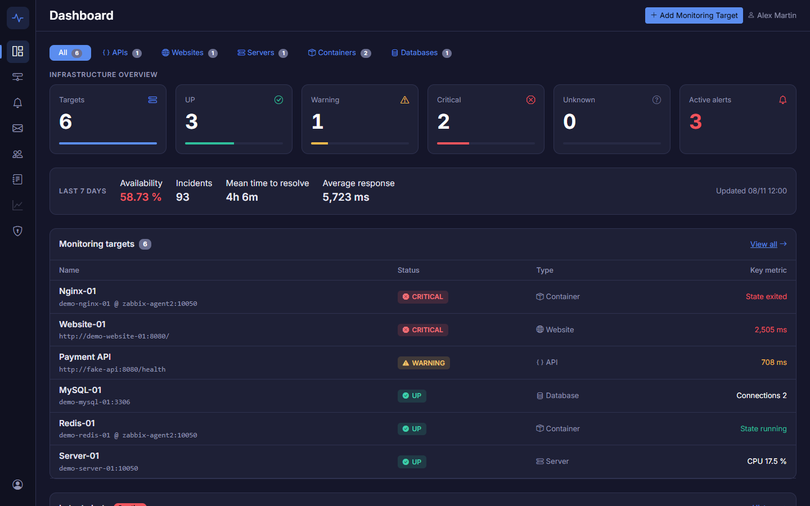
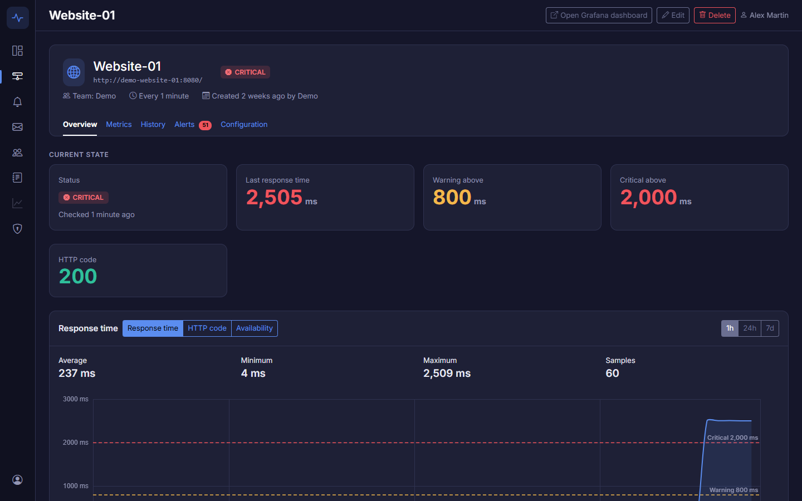
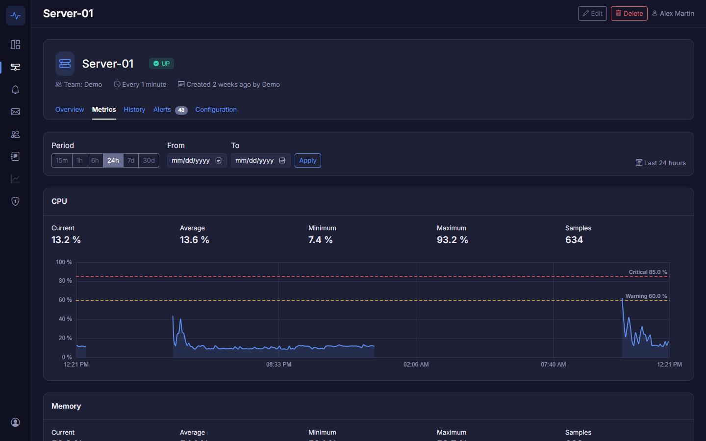
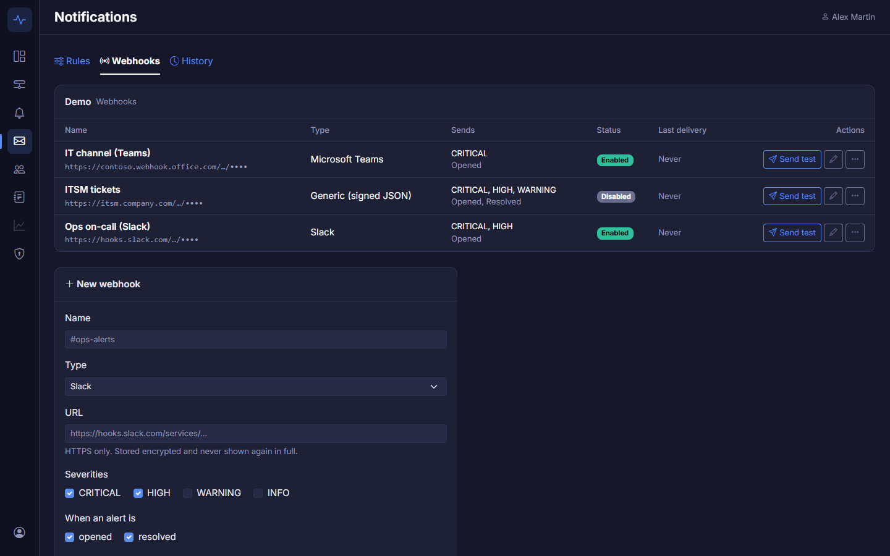
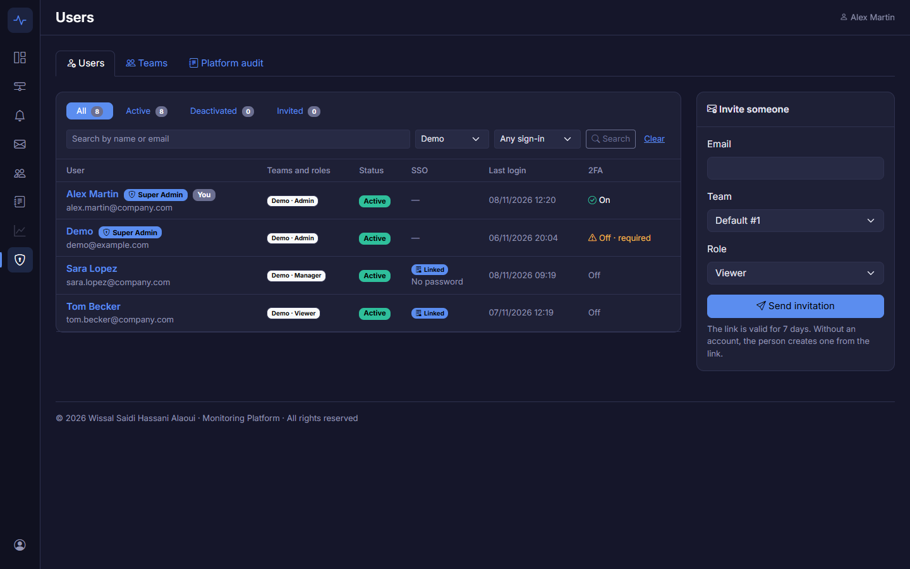
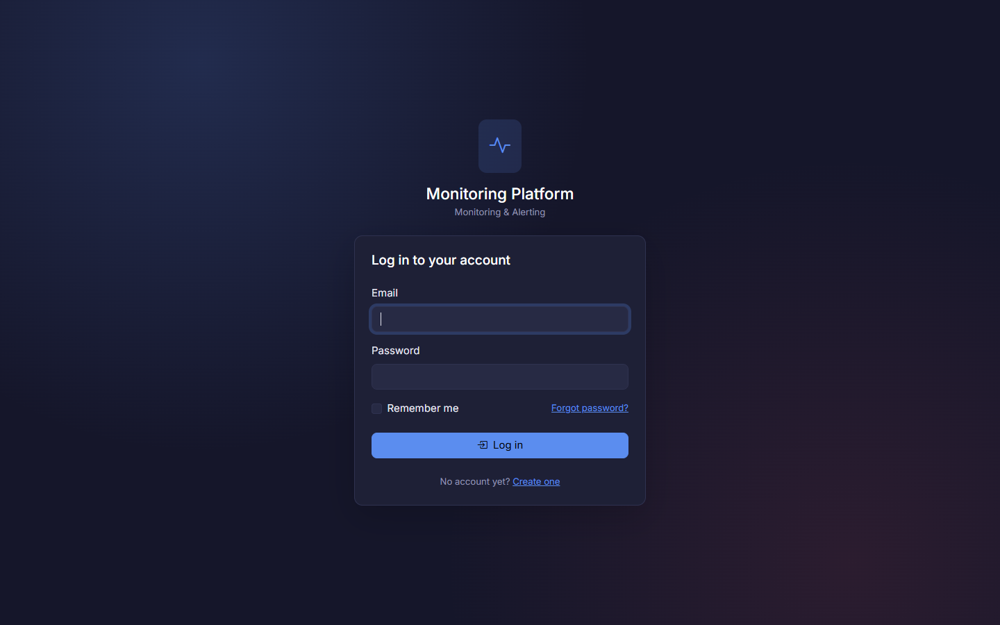

# Monitoring & Alerting Platform

A full-stack web platform to declare, monitor and visualize IT resources: APIs, websites, servers, Docker containers
and databases. Teams add their resources in a few clicks; the platform configures the monitoring, raises alerts,
notifies the right people (email, Slack, Microsoft Teams, signed webhooks) and keeps the history.

- **Laravel 12** (PHP 8.3): user interface (Blade, Bootstrap 5, Bootstrap Icons), business logic, alerts, access control
- **Zabbix 7.0**: monitoring engine, driven only through its API
- **Grafana**: advanced metric dashboards (Zabbix data source), one organization per team
- **Docker Compose**: the whole stack runs locally with one command

Project management: Jira (Scrum), GitHub Actions CI, 834 automated tests, eight releases (v0.1.0 to v0.8.0).

## Features

- **Monitoring of 5 resource types**: APIs, websites (including SSL certificate expiry), Linux servers (CPU, memory,
  disk), Docker containers and MySQL databases. Each target is created in Zabbix automatically (host, checks,
  triggers) from a simple form.
- **Alerts** synchronized from Zabbix every minute, with four severities, acknowledgement and full history.
- **Dashboards**: KPIs, availability over 7 / 30 days, MTTR, metric charts from 15 minutes to 30 days, incident
  timeline, and Grafana dashboards opened with single sign-on.
- **Notifications**: email rules per severity, Slack and Microsoft Teams messages, HMAC-signed generic webhooks,
  delivery history, automatic disabling of failing webhooks.
- **Teams and roles**: Viewer, Manager and Admin per team, invitations, audit log.
- **Platform administration**: Super Admin console (accounts, teams, deactivation, platform audit), invitation-only
  access, mandatory two-factor authentication (TOTP) for administrators.
- **Enterprise SSO** (OpenID Connect: Microsoft Entra ID, Okta, Keycloak): PKCE, verified ID tokens, account linking
  and creation rules, mandatory SSO with a break-glass account, directory MFA, session lifetime, provider logout.
- **Security by design**: STRIDE threat model, OWASP Top 10 checklist, SSRF protection, strict CSP, encrypted secrets,
  GDPR account deletion, `security:check` before production.

## Screenshots

| **Dashboard** | **Target page** |
|---|---|
|  |  |
| **Metrics** | **Webhooks (Slack, Teams, generic)** |
|  |  |
| **Administration console** | **Sign in with SSO** |
|  |  |

All screens, annotated (in French): [docs/conception/07-ecrans.md](docs/conception/07-ecrans.md).

## Architecture

```
browser ──► nginx :8000 ──► app (Laravel, PHP-FPM) ──► mysql (Laravel database)
                                 │                  └─► redis (cache / queues) ◄── queue + scheduler
                                 └── JSON-RPC API ──► zabbix-web :8080 ──► zabbix-server ──► targets
                                                                │              │           (e.g. fake-api)
browser ──► grafana :3000 ── Zabbix data source ────────────────┘              └──► zabbix-agent2 :10050
                                                                                     ├─► docker-socket-proxy ──► Docker (read only)
                                                                                     └─► mysql (zbx_monitor, read only)
```

| Service | URL from the host | Role |
|---|---|---|
| `nginx` + `app` | http://localhost:8000 | Laravel application |
| `mysql` | `localhost:3307` | Laravel database |
| `redis` | — | Cache and queues |
| `queue` + `scheduler` | — | Queue worker and Laravel Scheduler: Zabbix sync every minute |
| `zabbix-web` | http://localhost:8080 (`Admin` / `zabbix`) | Zabbix UI and API |
| `zabbix-server` + `zabbix-db` | — | Zabbix engine and its own database |
| `zabbix-agent2` | — | Zabbix agent 2: servers, containers, databases ([details](#zabbix-agent-2)) |
| `docker-socket-proxy` | — | Docker socket filter: the agent can only read |
| `mysql-monitor-user` | — | One-shot: creates the agent's MySQL user `zbx_monitor`, then stops |
| `grafana` | http://localhost:8000/grafana/ (users) · http://localhost:3000/grafana/ (`admin` / `GRAFANA_ADMIN_PASSWORD`) | Dashboards |
| `fake-api` | http://localhost:8081/health | Demo API with adjustable latency |
| `phpmyadmin` | http://localhost:8082 | phpMyAdmin: web UI for the MySQL databases (dev) |
| `mailpit` | http://localhost:8025 | Dev mailbox: password reset, email verification, notifications |

## Installation

Requirements: Docker Desktop, Node 20+ (to build the front end).

```bash
cp .env.example .env               # then change the passwords
docker compose up -d --build       # first start ≈ 5 min (Zabbix creates its database)

docker compose exec app composer install
docker compose exec app php artisan key:generate
docker compose exec app php artisan migrate
docker compose exec app php artisan platform:create-admin <your-email>   # first Super Admin (password prompted)

npm install
npm run build                      # or "npm run dev" while developing
```

### Zabbix API token

Laravel authenticates to Zabbix with an **API token** (never with a password):

1. Zabbix (http://localhost:8080) → *Users* › *API tokens* › **Create API token**
   (name: `laravel-app`, user: `Admin`, no expiry date in dev)
2. Copy the token into `.env` → `ZABBIX_API_TOKEN=...`
3. Check: `docker compose exec app php artisan zabbix:check`

Calls are logged in `storage/logs/zabbix-<date>.log` (INFO / ERROR, without token or parameters).

### Alert synchronization

Every minute, the scheduler pushes the `SyncZabbixEvents` job to the Redis queue: it reads the Zabbix problems,
creates or resolves alerts and updates the target status (UP / WARNING / CRITICAL / UNKNOWN).

| Zabbix | Platform |
|---|---|
| 0 Not classified, 1 Information | INFO |
| 2 Warning, 3 Average | WARNING |
| 4 High | HIGH |
| 5 Disaster | CRITICAL |

Run a sync right away: `docker compose exec app php artisan zabbix:sync`.
After changing PHP code, restart the worker: `docker compose restart queue`.

On Windows, the container's `vendor/` lives in a Docker volume (otherwise each page takes several seconds).
After any change to `composer.json`: `docker compose exec app composer install`.

Every `artisan` command goes through the container: `docker compose exec app php artisan …`
(from Windows, the hosts `mysql`, `redis` and `zabbix-web` do not exist).

## Target types

| Type | What Zabbix checks | Alerts |
|---|---|---|
| **API** | Web scenario `api-check`: expected 2xx code, response time, HTTP code | Unavailable (CRITICAL), slow (WARNING / HIGH depending on thresholds) |
| **Website** | Same as API (web scenario `website-check`) + for an `https://` URL, the SSL certificate expiry date, read every hour by Zabbix agent 2 | Same alerts + certificate expiring in less than 14 days (WARNING) then 3 days (HIGH); an expired certificate raises HIGH |
| **Server** | Zabbix agent installed on the server (address + port), template `Linux by Zabbix agent`: CPU, memory, disk /, load, uptime, OS | Unavailable (no answer for 3 min, CRITICAL), CPU / memory / disk above the % thresholds (WARNING then HIGH, 5-minute average) |
| **Container** | Docker container read by the Zabbix agent 2 of its host (Docker plugin, `zabbix-agent2` by default): state, CPU, memory, network, restarts, uptime | Container stopped or missing (CRITICAL), more than 2 restarts in 10 min (HIGH), memory above the threshold in MB (WARNING) |
| **Database** | MySQL read by the platform's Zabbix agent 2 (MySQL plugin) with a read-only user: availability, connections, slow queries, queries/s, version, uptime; response time = TCP connection measured by the Zabbix server | Database unreachable (CRITICAL), connections above the threshold (WARNING) |

A database password is **encrypted** in the database (`APP_KEY`), never displayed, logged or sent back in the form;
Zabbix receives it in a secret macro. Left empty on edit, it stays unchanged.

Each type has its own screens: the **dashboard** filters by category (All, APIs, Websites, Servers, Containers,
Databases), the **target list** shows the columns of the filtered type (response time, CPU, container state…), the
**target page** its cards and charts (response time, CPU / memory / disk, connections…), and the **Monitoring** menu
opens each type.

Other types (network) appear greyed out in the form until they are available. The same SSRF protection applies to
every type that calls a URL. For a server, only the triggers created by the platform become alerts: those of the Linux
template stay visible in Zabbix. Demo server: `zabbix-agent2`, port `10050`.

## Teams, roles and security

**Platform Super Admin** (IT department): above the teams. Designated from the command line, never from the web, with
no rights inside a team they are not a member of.

```bash
docker compose exec app php artisan platform:create-admin it.admin@company.com   # new account (password prompted) or promotion
docker compose exec app php artisan platform:create-admin demo@example.com       # demo environment: promote the demo account
docker compose exec app php artisan platform:list-admins
docker compose exec app php artisan platform:revoke-admin it.admin@company.com   # refused for the last Super Admin
docker compose exec app php artisan platform:invite jane@company.com Payments --role=admin   # invitation into any team
```

**Account creation**, set by `REGISTRATION_MODE` in `.env`:

| Mode | Sign-up |
|---|---|
| `invite` (default) | no sign-up page (404): people only join by invitation |
| `domain` | open to the domains of `REGISTRATION_DOMAINS` (e.g. `company.com,company.fr`) |
| `open` | open to everyone, for a public demo |

**Invitations are the normal way in**, whatever the mode. For an address without an account, the link opens "Create
your account": the email is prefilled and locked, considered verified, and the person lands directly in the team with
the chosen role. With an existing account, they log in and join the team. The link is signed, valid for 7 days and
single-use.

No team is created at sign-up. An account without a team sees the **Waiting for access** page (its address, and the
`REGISTRATION_CONTACT` contact if set) until a team Admin adds it. Super Admins get an email as soon as a new account
has verified its address.

**Administration console** (shield menu, `/admin/users`): every account (teams and roles, Super Admin, status, last
login, 2FA, SSO) with search and filters, and the **Invited** tab for pending invitations. On an account page:

- invite, add to a team, change role, remove from a team; promote or revoke Super Admin;
- **deactivate** instead of delete: login refused, sessions closed, Grafana access removed, no more notifications;
  teams, history and audit kept; reactivation in one click;
- **force a password reset**: the old password stops working, sessions are closed and the "forgot password" email is
  sent.

Safeguards: you cannot deactivate yourself, the last active Super Admin stays, and a team always keeps an active Admin.

**Two-factor authentication**: TOTP code from an app (Google Authenticator, Microsoft Authenticator, 1Password…) after
the password, and 8 recovery codes. Everyone can turn it on from **My account → 2FA**. It is **mandatory for Super
Admins and team Admins**: without it, they are sent to the setup page (and Grafana is closed to them). Lost phone and
no recovery code left: a Super Admin resets it from the account page. `TWO_FACTOR_FOR_ADMINS=false` turns the
requirement off, for a throwaway demo only.

**Teams** (`/admin/teams`): teams are created by the IT department, not at sign-up. List (Admins, members, targets,
active alerts); creation with the first Admin (an existing account is added, an unknown address is invited as Admin),
along with its Zabbix host group and Grafana organization; renaming (Zabbix and Grafana follow); deletion by typing the
exact name: targets removed from Zabbix, Grafana organization deleted, member accounts kept.

**Platform audit** (`/admin/audit`): entries of every team and platform actions (accounts, Super Admins, deleted
teams), filtered by team (or "Platform only"), action, author and dates.

Roles inside a team:

| Role | Can |
|---|---|
| **Viewer** | see the dashboard, the targets and the alerts |
| **Manager** | + create, edit, delete targets and acknowledge alerts |
| **Admin** | + invite and manage members, read the audit log, configure the team |

- **Members** (`/teams/{team}/members`): email invitation (signed link valid 7 days), role change, removal; a team
  always keeps at least one Admin.
- **Audit log** (`/teams/{team}/audit`): who did what and when, filtered by action, member and period; purged after
  1 year (`audit:purge`).
- **My account**: deletion of the account and personal data (GDPR), anonymized audit.
- **SSRF**: a target cannot point to an internal address (`localhost`, private network…), checked after DNS resolution.
- **Headers**: CSP without inline scripts, `X-Frame-Options`, `nosniff`, HSTS over HTTPS. No `onclick=` / `onchange=`
  in the views: use `data-auto-submit` and `data-confirm`.

Threat model: [docs/conception/06-menaces-stride-owasp.md](docs/conception/06-menaces-stride-owasp.md).

## Operations

| Topic | Command | Documentation |
|---|---|---|
| Backups of both databases (every night at 02:30 UTC, kept 7 days) | `php artisan backup:run`, `backup:list`, `backup:restore` | [sauvegardes.md](docs/exploitation/sauvegardes.md) |
| Production (HTTPS, `APP_DEBUG=false`, 14 days of logs) | `docker compose -f docker-compose.yml -f docker-compose.prod.yml up -d`, then `php artisan security:check` | [production.md](docs/exploitation/production.md) |
| Dependency and image updates | monthly routine, `npm audit` and `composer audit` in CI | [mises-a-jour.md](docs/exploitation/mises-a-jour.md) |

## Browsing the databases (phpMyAdmin)

http://localhost:8082. Port 3307 is a MySQL port: it does not open in a browser.

| Server (drop-down list) | User | Password |
|---|---|---|
| **Laravel** | `DB_USERNAME` | `DB_PASSWORD` |
| **Zabbix** | `zabbix` | `ZBX_DB_PASSWORD` |

Values are in `.env`. The Zabbix database is read only: it is always changed through the API.

## Fake demo API

```bash
curl -s "http://localhost:8081/control?delay=1200"      # makes the API slow (1.2 s)
curl -s "http://localhost:8081/control?mode=error"      # returns 500 errors
curl -s "http://localhost:8081/control?mode=ok&delay=0" # back to normal
```

Seen from Zabbix, its address is `http://fake-api:8080/health` (Docker service name).

## Demo environment

One resource of each type, and outages to trigger:

- Server-01, Website-01, MySQL-01, Redis-01 and Nginx-01, in addition to the fake API;
- outages: high CPU, filling disk, slow website, stopped container, unreachable database.

```bash
docker compose --profile demo up -d                                          # "demo" profile: not started by default
docker compose exec -u www-data app php artisan db:seed --class=DemoSeeder   # account demo@example.com, team Demo, 6 targets
```

Outage commands and demo scenario (in French): [`docs/demo/README.md`](docs/demo/README.md).

## SSO (OpenID Connect)

Sign in with the company account (Microsoft Entra ID, Okta, Keycloak…) through OpenID Connect.

**Sign-in**: a "Sign in with …" button on the login page, as soon as the provider is configured in `.env`. Passwords
remain possible alongside.

| Variable | Role |
|---|---|
| `OIDC_ISSUER` | exact issuer of the provider (`iss` claim); empty = no SSO |
| `OIDC_INTERNAL_URL` | address used to read the discovery document from the container, if the issuer is not reachable there (empty otherwise) |
| `OIDC_CLIENT_ID`, `OIDC_CLIENT_SECRET` | confidential client created at the provider |
| `OIDC_SCOPES` | `openid email profile` by default |
| `OIDC_BUTTON_LABEL` | button text (e.g. "Sign in with Contoso") |
| `OIDC_TRUST_EMAIL` | `true` only for a provider that guarantees its emails without sending `email_verified` (Entra ID) |
| `OIDC_GROUPS_CLAIM` | claim carrying the directory groups (`groups` by default), used only when group mappings exist |

- Authorization code flow with **PKCE S256**, random `state` and `nonce`, bound to the session and single-use
  (10 minutes at most); the code is exchanged server-side with the client secret.
- Verified ID token: signature by the provider's keys (JWKS, fetched again when an unknown key appears), RS/ES
  algorithms only, `iss`, `aud` (and `azp`), `exp`, `iat`, `nonce`. Discovery and keys cached for 1 hour.
- The person is found by **`iss` + `sub`**; after that, never by email again.
- Deactivated account: refused. Platform 2FA turned on: the code is asked after SSO; an administrator without 2FA must
  set it up, as after a password.
- Any failure goes back to the login page with a generic message; details go to the logs, without token or code.
- Audit: `user.sso_link` (first link), `user.login_sso` (every sign-in).

**First sign-in**, with the same access rules as sign-up (`REGISTRATION_MODE`) and invitations:

| Situation | Result |
|---|---|
| existing account with the same email | linked, if the directory **vouches for the email** (`email_verified`, or `OIDC_TRUST_EMAIL`); otherwise refused |
| pending invitation for this email | account created **without a password**, in the team with the invitation's role (every pending invitation) |
| unknown person, `invite` mode | "Waiting for access" page, **no account created** |
| unknown person, `domain` mode | account created without a team if the domain is in `REGISTRATION_DOMAINS`, otherwise as `invite` |
| unknown person, `open` mode | account created without a team |

- Name and email taken from the token (`name`, else `given_name` + `family_name`, else `preferred_username`). An
  account's email is **never changed** by the directory: a new email is reported in the audit (`user.sso_email_mismatch`).
- Account without a password: password login is impossible. Sensitive actions (turning on 2FA, deleting the account)
  require **signing in again at the provider** (`prompt=login`, `max_age=0`, `auth_time` checked, same `iss` + `sub`)
  instead of the password; the SSO sign-in itself counts as confirmation for 3 hours.
- "My account" shows the sign-in methods; SSO can be unlinked (password required) if a password remains. "Forgot
  password" still lets an SSO account choose one, as long as SSO is not mandatory.
- Console `/admin/users`: "SSO" column (linked, no password) and "Single sign-on / Password only" filter.
- Audit: `user.create` (`via: sso`, team or mode), `user.sso_link`, `user.sso_unlink`, `user.sso_email_mismatch`.

With the demo Keycloak (below), in `.env`:

```bash
OIDC_ISSUER=http://localhost:8180/realms/monitoring
OIDC_INTERNAL_URL=http://keycloak:8080/realms/monitoring
OIDC_CLIENT_ID=monitoring-platform
OIDC_CLIENT_SECRET=     # KEYCLOAK_DEMO_CLIENT_SECRET, read from the Keycloak volume
```

To try it: invite `victor.viewer@company.com` into a team (Viewer role), then "Sign in with SSO" with this Keycloak
account: the account is created and joins the team. `nina.newcomer` (never invited) sees "Waiting for access",
`eve.unverified` is refused.

**Demo Keycloak**: a local "company directory", to test without an Entra ID or Okta tenant.

```bash
docker compose --profile sso up -d keycloak     # "sso" profile: not started by default (~1 min on first start)
docker compose exec keycloak cat /opt/keycloak/data/demo/secrets.env   # secrets generated on first start
```

- Login page and console: http://localhost:8180 (console: `admin` / `KEYCLOAK_ADMIN_PASSWORD`).
- Realm `monitoring`, imported on first start from `docker/keycloak/import/monitoring-realm.json`.
- **No password in the repository**: the empty `.env` values (`KEYCLOAK_ADMIN_PASSWORD`, `KEYCLOAK_DEMO_CLIENT_SECRET`,
  `KEYCLOAK_DEMO_USER_PASSWORD`) are generated on first start and kept in the `keycloak-data` volume. To start over:
  `docker compose --profile sso down` then `docker volume rm monitoring-platform_keycloak-data`.
- Client `monitoring-platform`: confidential, authorization code flow only, **PKCE S256 required**, redirect URI
  `http://localhost:8000/auth/oidc/callback`, `groups` claim in the ID token.
- Issuer (`iss`): always `http://localhost:8180/realms/monitoring`. The browser goes through `localhost:8180`; the
  application calls `http://keycloak:8080` for the token and the keys (`KC_HOSTNAME_BACKCHANNEL_DYNAMIC`).

Test users (shared password: `KEYCLOAK_DEMO_USER_PASSWORD`):

| User | Group | Used to test |
|---|---|---|
| `alice.admin@company.com` | `monitoring-demo-admins` | sign-in of an Admin |
| `victor.viewer@company.com` | `monitoring-demo-viewers` | sign-in of a Viewer |
| `olivia.otp@company.com` | `monitoring-demo-admins` | MFA: sets up an OTP at first sign-in |
| `nina.newcomer@company.com` | — | directory user never invited |
| `eve.unverified@company.com` | — | email **not verified** by the directory (`email_verified: false`) |

**At a real provider**, a "web" (confidential) OpenID Connect application:

- redirect URI: `https://<platform>/auth/oidc/callback`; post-logout URI: `https://<platform>/login`;
- authorization code flow with PKCE; scopes `openid email profile`;
- expected claims: `sub`, `email`, `email_verified`, `name`, and `groups` if directory groups are mapped to teams;
- Entra ID: "App registrations", "Web" platform, client secret; `email_verified` is not sent: `OIDC_TRUST_EMAIL=true`
  if the directory emails are managed by the company; groups: "Token configuration → Add groups claim";
- Okta: "Applications → Create App Integration → OIDC, Web Application"; groups: `groups` claim on the authorization
  server;
- Keycloak: confidential client, "Standard flow", PKCE `S256`, "Group Membership" mapper (`groups`, without path).

**Mandatory SSO, directory MFA, break-glass account**:

| Variable | Role |
|---|---|
| `SSO_REQUIRED` | `true`: only the SSO button remains; password login refused server-side, sign-up and "forgot password" disabled (no effect until the provider is configured) |
| `SSO_SESSION_LIFETIME` | lifetime of a session opened by SSO, in minutes (480 = 8 h), then a new trip through the directory |
| `OIDC_MFA_ACR` | `acr` values that prove MFA at the provider (comma-separated), in addition to `amr` |

- **Mandatory SSO**: sessions opened otherwise (earlier password, "remember me") are closed at the next request. An
  invitation ends with "Sign in with SSO" (account created at sign-in). SSO can no longer be unlinked, and the console
  can no longer force a password reset.
- **Break-glass account**: a Super Admin designated with `php artisan platform:break-glass <email>` (`--revoke` to
  remove; an account without a password chooses one interactively) keeps their password and the platform 2FA, on
  **`/login/break-glass`** (page absent when SSO is not mandatory). Each use is audited (`user.login_break_glass`) and
  emailed to the other Super Admins. `platform:list-admins` shows it.
- **Directory MFA**: if the token proves MFA (`amr` contains `mfa`, `otp`, `hwk`, `swk`, `sc`, `fpt`…, or `acr` is in
  `OIDC_MFA_ACR`), the platform 2FA is neither asked nor required for administrators. Otherwise it is, as after a
  password. Keycloak 26.5 sends an empty `amr`: the platform 2FA is therefore still asked with the demo Keycloak
  (unless `OIDC_MFA_ACR` matches its authentication level configuration).
- **Session lifetime**: an SSO (or break-glass) session lasts `SSO_SESSION_LIFETIME`, even for an active user; an
  account disabled in the directory loses access at the latest at that point.
- **Logout**: "Log out" also ends the session at the provider (`end_session_endpoint`, with `id_token_hint` and a
  return to `/login`), if it publishes one. The ID token is kept in the server-side session for that purpose. The CSP
  allows the provider's origin in `form-action` (otherwise the browser blocks the redirect after the "Log out" form).
- `php artisan security:check` fails if `SSO_REQUIRED=true` without a configured provider or without a break-glass
  account.
- Audit: `platform.sso_required` (setting changed, detected at startup), `platform.break_glass_grant` / `_revoke`,
  `user.login_break_glass`; `user.login_sso` shows `mfa: directory`.

Before setting `SSO_REQUIRED=true`: sign in once with SSO with every administrator account (linking), designate the
break-glass account and test `/login/break-glass`, then run `security:check`.

**Directory groups → teams and roles** (optional): in large companies, team membership already lives in the directory.

- Off by default: without any mapping, teams and roles are managed in the platform only.
- A Super Admin maps a directory group to a team and a role (Admin, Manager, Viewer) on the team page
  (`/admin/teams/{team}` → **Directory groups**). The claim name is `OIDC_GROUPS_CLAIM` (`groups` by default); Keycloak
  and Okta send group names (a leading `/` of a Keycloak path is ignored), Entra ID sends group IDs.
- Applied **at every SSO sign-in**: the person joins the team, or their role changes, when one of their groups matches;
  several groups for the same team give the highest role. A membership that came from a group ends when the group
  disappears from the token (or when its mapping is removed); memberships added by hand are never removed.
- A token without the groups claim changes nothing, so a provider misconfiguration cannot empty the teams.
- **Never Super Admin** through a group: that role stays command-line only.
- A team never loses its last active Admin through a sync: the change is refused, audited (`member.sync_blocked`) and
  emailed to the Super Admins (at most once a day per person and team).
- The origin is shown on the account and team pages ("from directory group …").
- Audit: `member.add`, `member.role_change`, `member.remove` with `via: sso_group` and the group (author "Directory");
  `team.group_map` / `team.group_unmap` for the mappings.
- With the demo Keycloak: map `monitoring-demo-viewers` (Viewer) or `monitoring-demo-admins` to a team, then sign in
  as `victor.viewer` or `alice.admin`.

## Zabbix agent 2

Servers, containers and databases are monitored with Zabbix agent 2 (service `zabbix-agent2`). It runs in **passive
mode**: `zabbix-server` polls it on `zabbix-agent2:10050`, the only allowed server. No port is published on the host.
The platform creates the hosts with an agent interface pointing to this address (`ZABBIX_AGENT_HOST` /
`ZABBIX_AGENT_PORT`).

| Plugin | Access given to the agent |
|---|---|
| **Docker** | The Docker socket goes through `docker-socket-proxy`: only the reads used by the plugin are allowed (info, containers, images, disk usage). Creating, starting or deleting a container, or reading its files, is refused (403 / 405). A plain `docker.sock:ro` mount does not protect anything: it allows everything. |
| **MySQL** | User `zbx_monitor` (password `ZBX_MONITOR_DB_PASSWORD`), with the official template's privileges: `PROCESS`, `REPLICATION CLIENT`, `SHOW DATABASES`, `SHOW VIEW`. It reads no data. The agent stores no credentials: Zabbix passes them through the host's **secret** macros `{$MYSQL.USER}` / `{$MYSQL.PASSWORD}`. |

Test a key directly in the agent:

```bash
docker compose exec zabbix-agent2 zabbix_agent2 -t docker.ping       # [s|1]
docker compose exec zabbix-agent2 zabbix_agent2 -t docker.containers
docker compose run --rm mysql-monitor-user                            # recreates zbx_monitor (e.g. after a password change)
```

## Notifications

When the sync creates an alert, team members receive an email according to the team rules, then a second one when it
is resolved. By default: CRITICAL and HIGH by email, WARNING and INFO on the dashboard only. Only the people notified
when an alert opened are notified when it is resolved.

- Opening: severity, target, metric, measured value, threshold, start time and link to the alert.
- Resolution: start, end, incident duration, peak value ("—" if unknown) and link to the history.
- Sent through the Redis queue (`queue` service): the sync never waits for the mail server. On SMTP failure: 3
  attempts, then the notification is marked as failed (`notifications` table) and the error is logged.
- Locally, emails land in Mailpit: http://localhost:8025.
- **Notifications** page (envelope menu): for each severity, "Email" or "Dashboard only", on opening and on
  resolution. Every member sees the rules; only Admins and Managers change them, and every change is written to the
  audit log.
- **History** tab of the same page: every notification of the team (date, alert, event, recipient, channel, status
  sent / pending / failed), filtered by status and target, 25 per page. In the alert lists, the envelope icon of an
  alert opens its notifications. Email addresses and SMTP error details are only visible to Admins. Webhook deliveries:
  webhook name, HTTP code and number of attempts; filters by channel (email / webhook) and by webhook.

## Webhooks

A team can notify other tools when its alerts open and resolve: an HTTP call to an internal tool (ITSM, on-call), or a
Slack or Microsoft Teams message. Each webhook chooses its severities and events, independently of the emails.
Deliveries go through the Redis queue (3 attempts, after 30 s then 2 min) and appear in the notification history.

**Generic webhook**: `POST` of a versioned JSON document.

```json
{
  "version": 1,
  "event": "alert.opened",
  "delivery_id": "ccfbec4a-dd18-574c-9a73-eb3f017208fc",
  "sent_at": "2026-11-07T09:01:30Z",
  "alert": {
    "id": 522, "severity": "high", "status": "open", "message": "Response time > 2000 ms",
    "metric": "response_time", "value": 3017.004, "threshold": 2000, "peak_value": null,
    "started_at": "2026-11-07T09:00:00Z", "resolved_at": null,
    "url": "https://monitoring.company.com/targets/24?tab=alerts"
  },
  "target": { "id": 24, "name": "Website-01", "type": "website" },
  "team": { "id": 9, "name": "Demo" }
}
```

| Header | Content |
|---|---|
| `X-Platform-Event` | `alert.opened` or `alert.resolved` |
| `X-Platform-Delivery` | delivery ID, the same on every retry: keep it to ignore duplicates |
| `X-Platform-Timestamp` | send time (Unix seconds) |
| `X-Platform-Signature` | `sha256=` + HMAC-SHA256, with the webhook secret, of `<timestamp>.<raw body>` |

Verify the signature on the receiving side. The timestamp is signed with the body: refusing old messages blocks
replays.

```php
$body = file_get_contents('php://input');                      // raw body, before any json_decode
$timestamp = $_SERVER['HTTP_X_PLATFORM_TIMESTAMP'] ?? '';
$expected = 'sha256='.hash_hmac('sha256', $timestamp.'.'.$body, getenv('WEBHOOK_SECRET'));

if (! hash_equals($expected, $_SERVER['HTTP_X_PLATFORM_SIGNATURE'] ?? '') || abs(time() - (int) $timestamp) > 300) {
    http_response_code(401);
    exit;
}
```

```python
import hashlib, hmac, time

def verify(body: bytes, timestamp: str, signature: str, secret: str) -> bool:
    expected = "sha256=" + hmac.new(secret.encode(), timestamp.encode() + b"." + body, hashlib.sha256).hexdigest()
    return hmac.compare_digest(expected, signature) and abs(time.time() - int(timestamp)) <= 300
```

Answer with a 2xx code within 5 s. Redirects are not followed, and the address is checked again on every delivery (no
internal address). Locally, `fake-api` acts as a receiver: `POST http://fake-api:8080/webhook`, then
`GET http://localhost:8081/webhook/received` shows what was received.

**Slack and Microsoft Teams**: a readable message in the channel, colored by severity (green on resolution), with the
target, metric, value and threshold, start time, then duration and peak value on resolution, and a "View alert"
button. No signature: the secret URL acts as the token (it is encrypted in the database and never displayed in full).

- Slack: an app with "Incoming Webhooks" enabled, then "Add New Webhook to Workspace" and the channel choice. The URL
  starts with `https://hooks.slack.com/services/`.
- Microsoft Teams: in the channel, "Workflows", then the template "Post to a channel when a webhook request is
  received". The URL is given at the end of the wizard. The message is an Adaptive Card.

Try a URL before saving it: a sample message is built from the latest alert. The URL is typed hidden and is not
saved.

```bash
docker compose exec app php artisan webhooks:try slack               # or teams, or generic
docker compose exec app php artisan webhooks:try teams --resolved    # resolution message
```

**Managing webhooks**: Notifications page, **Webhooks** tab.

- List: name, type, severities and events, state (and consecutive failures), last delivery. A Viewer sees the list
  without the addresses or the actions.
- Admins and Managers (`notification.manage`): create, edit, disable / enable, delete (the delivery history is kept).
  10 webhooks at most per team.
- The URL is never displayed in full again (`https://hooks.slack.com/…/••••`); on edit, an empty field keeps the
  current address.
- Generic webhook: the signing secret is shown **only once**, after creation or regeneration ("…" menu → "Regenerate
  secret"; the old one stops working immediately).
- **Send test**: immediate delivery of a sample alert ("Sample target", most severe chosen severity), result shown on
  the row (HTTP code and duration, or error). For a generic webhook, the event is `alert.test` and the body contains
  `"test": true`. Nothing is saved.
- Audit: `webhook.create`, `webhook.update`, `webhook.delete`, `webhook.secret_rotate`, without the URL or the secret.

**Automatic disabling**: a notification counts as a failure once its 3 attempts are used up. At the **10th consecutive
failure**, the webhook is disabled: the team Admins receive an email (name, last error, link to the page, never the
URL) and the audit keeps `webhook.auto_disable` (author "System"). A successful delivery resets the counter. The
webhook is enabled again by hand, from the "…" menu of the Webhooks tab, ideally after a successful "Send test";
enabling it also resets the counter.

## Metrics tab

On a target page, the **Metrics** tab shows every metric of the type over the chosen period:

- periods: 15 min, 1 h, 6 h, 24 h, 7 d, 30 d, or start and end dates (up to one year);
- for each metric (response time, HTTP code, CPU, memory, disk, connections…, and **availability** for every type):
  current value, average, minimum, maximum, number of measurements and chart with its thresholds;
- from 7 days on, Zabbix hourly trends replace the raw history: 30 days display in less than a second.

## History tab

The **History** tab of a target:

- availability today, over 7 and 30 days, number of incidents, mean time to resolution (MTTR) and average response
  time: **daily statistics** computed every hour (`php artisan stats:compute`), without any Zabbix call when the page
  is displayed. Availability = the lowest of the share of successful checks and the share of time outside
  "unavailable" incidents; "—" when there is no measurement. The dashboard shows the 7-day summary;
- incident timeline over the chosen period (24 h, 7 d, 30 d or dates), in the color of their severity;
- incident list: start, end, duration, severity, **peak value** reached during the incident (read from Zabbix, kept
  once the incident is resolved) and threshold.

## Grafana

Grafana reads Zabbix through the Zabbix plugin data source (provisioned in `docker/grafana/provisioning/`).

**Access**:

- platform users go through **http://localhost:8000/grafana/**, signed in automatically (auth proxy: nginx asks
  Laravel who is logged in), with no Grafana account or password to remember;
- each team has its own Grafana organization. Its data source connects with a read-only Zabbix user limited to the
  team's host group. A user is **Viewer** of their teams' organizations, and nothing else: they only see their hosts;
- organization, Zabbix user, data source and dashboard are created at the first click on "Open Grafana dashboard". A
  member removed from a team loses access immediately. `php artisan grafana:sync` (every hour) repairs and updates the
  dashboards;
- the administrator keeps direct access: http://localhost:3000/grafana/ (`admin` / `GRAFANA_ADMIN_PASSWORD`). This
  password is only used by the platform, server-side.

The **Target overview** dashboard (*Monitoring Platform* folder) serves every target:

- at the top: the team, then one of its targets;
- availability, HTTP code, availability over time, active Zabbix problems;
- response time, with the target's warning and critical thresholds as dotted lines.

On the page of an API, website or database, the **Open Grafana dashboard** button opens this dashboard in the team's
organization, already set to the target and to the chart period. Before going there, the application checks that
Grafana answers (`GRAFANA_INTERNAL_URL`, state cached 30 s). Otherwise, the page shows "Advanced metrics are
temporarily unavailable.". The link uses `GRAFANA_URL`, the address seen by the browser.

The dashboard is versioned in `docker/grafana/provisioning/dashboards/target-overview.json`. It can be changed in
Grafana but not saved there: change the file.

Thresholds come from Zabbix: each target has `platform.threshold[series,level]` items, updated when its thresholds
change. For targets created before this version:

```bash
docker compose exec -u www-data app php artisan zabbix:sync-thresholds
```

## Tests and quality

```bash
php artisan test          # tests (in-memory SQLite, no Docker needed)
vendor/bin/pint           # code style (PSR-12 / Laravel)
```

The GitHub Actions CI (`.github/workflows/ci.yml`) runs: PHP syntax, Pint, `composer audit`, `npm audit`, tests, Vite
build and Docker image build.

## Documentation

The design and operations documents are written in French.

- [`docs/conception/`](docs/conception/README.md): use cases, requirements, risks, data model, sequence diagrams,
  STRIDE, screens
- [`docs/exploitation/`](docs/exploitation/): backups, production, updates
- [`docs/demo/`](docs/demo/README.md): demo environment, triggered outages, scenario
- [`docs/poc-zabbix/`](docs/poc-zabbix/README.md): proof of concept, driving Zabbix through its API
- [`CONTRIBUTING.md`](CONTRIBUTING.md): branches, commits, pull requests

## Author and license

Designed and developed by **Wissal Saidi Hassani Alaoui** ([@wissalsaidi](https://github.com/wissalsaidi)).

Copyright © 2026 Wissal Saidi Hassani Alaoui. **All rights reserved.** The source code is published for viewing and
evaluation only: it may not be copied, modified, redistributed or used, in whole or in part, without prior written
permission. See [LICENSE](LICENSE).
