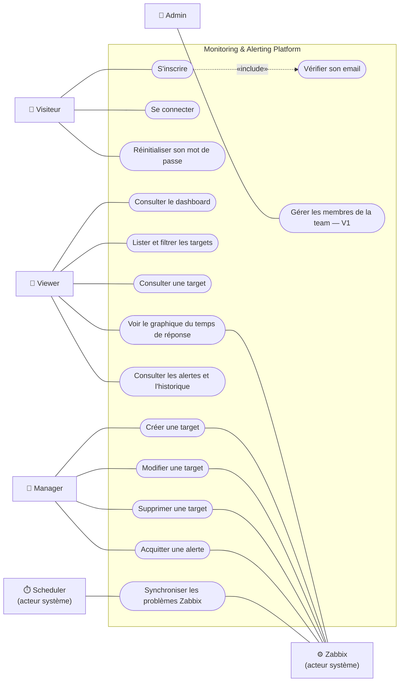

# Acteurs et cas d'utilisation

**Objectif :** savoir qui utilise la plateforme et ce que chacun peut faire, avant de parler technique.

**Ticket Jira :** [SCRUM-16](https://wissalshalaoui.atlassian.net/browse/SCRUM-16)

## Les acteurs

| Acteur | Type | Description |
|---|---|---|
| **Visiteur** | humain | Personne qui n'a pas encore de compte ou n'est pas connectée. Elle peut seulement créer un compte, se connecter ou réinitialiser son mot de passe. |
| **Viewer** | humain | Membre d'une team qui **consulte** : dashboard, targets, alertes, graphiques. Il ne modifie rien. |
| **Manager** | humain | Membre d'une team qui **gère la supervision** : il fait tout ce que fait un Viewer, et en plus il crée, modifie et supprime des targets et acquitte les alertes. |
| **Admin** | humain | Responsable de la team. Il a les mêmes droits qu'un Manager dans le MVP ; la gestion des membres et des rôles arrive en V1/V2. Celui qui s'inscrit devient Admin de sa team « Default ». |
| **Zabbix** | système | Moteur de supervision. Il reçoit la configuration envoyée par la plateforme, vérifie les URLs, détecte les problèmes et les résout. |
| **Scheduler Laravel** | système | Horloge interne. Chaque minute, il lance la synchronisation des problèmes Zabbix vers les alertes. |

Les rôles s'emboîtent : **Viewer ⊂ Manager ⊂ Admin**. Chaque personne ne voit que les targets et les alertes des teams dont elle est membre.

Depuis la V1 (SCRUM-58), chaque rôle correspond à une liste de **permissions nommées** :

| Permission | Viewer | Manager | Admin |
|---|:---:|:---:|:---:|
| `dashboard.view`, `target.view`, `alert.view` | ✅ | ✅ | ✅ |
| `target.create`, `target.update`, `target.delete` | — | ✅ | ✅ |
| `alert.acknowledge` | — | ✅ | ✅ |
| `user.view`, `user.create`, `user.update`, `user.delete` | — | — | ✅ |
| `configuration.manage` | — | — | ✅ |

## Diagramme de cas d'utilisation

**Héritage des rôles** (non dessiné pour garder le schéma lisible) : un Manager peut faire tout ce que fait un Viewer, et un Admin tout ce que fait un Manager.

## Description des cas d'utilisation

| Cas d'utilisation | Acteur principal | Ce qui se passe | Ticket |
|---|---|---|---|
| S'inscrire | Visiteur | Création du compte et d'une team « Default » dont il devient Admin. Un email de vérification est envoyé. | SCRUM-30, 31 |
| Se connecter | Visiteur | Email + mot de passe, 5 essais par minute maximum. | SCRUM-30 |
| Réinitialiser son mot de passe | Visiteur | Lien envoyé par email, valable 60 minutes. | SCRUM-32 |
| Vérifier son email | Visiteur | Lien signé valable 60 minutes ; obligatoire avant d'accéder à l'application. | SCRUM-32 |
| Consulter le dashboard | Viewer | KPIs (targets par statut, alertes actives), targets en difficulté, dernières alertes. | SCRUM-43 |
| Lister et filtrer les targets | Viewer | Filtres par statut, type et nom, pagination. | SCRUM-34 |
| Consulter une target | Viewer | Statut, dernier temps de réponse, seuils, alertes, configuration Zabbix. | SCRUM-36 |
| Voir le graphique du temps de réponse | Viewer | Courbe sur 1 h, 24 h ou 7 jours avec les seuils ; les mesures sont lues dans Zabbix. | SCRUM-44 |
| Consulter les alertes et l'historique | Viewer | Alertes actives et résolues, filtres par sévérité et par target, durée des incidents. | SCRUM-41 |
| Créer une target | Manager | Formulaire ; la plateforme crée dans Zabbix le host, le check et les 3 triggers. | SCRUM-33, 38 |
| Modifier une target | Manager | Nouveaux seuils, intervalle, nom ou URL envoyés à Zabbix. | SCRUM-35 |
| Supprimer une target | Manager | Après confirmation : suppression du host Zabbix, de la target et de ses alertes. | SCRUM-35 |
| Acquitter une alerte | Manager | L'alerte passe en ACKNOWLEDGED avec l'auteur ; l'acquittement est envoyé à Zabbix. | SCRUM-42 |
| Synchroniser les problèmes Zabbix | Scheduler | Chaque minute : nouveaux problèmes → alertes, résolutions → alertes RESOLVED, statut des targets mis à jour. | SCRUM-40 |
| Gérer les membres de la team | Admin | Inviter, retirer, changer un rôle. **Prévu en V1/V2** (RBAC, SCRUM-14). | — |
