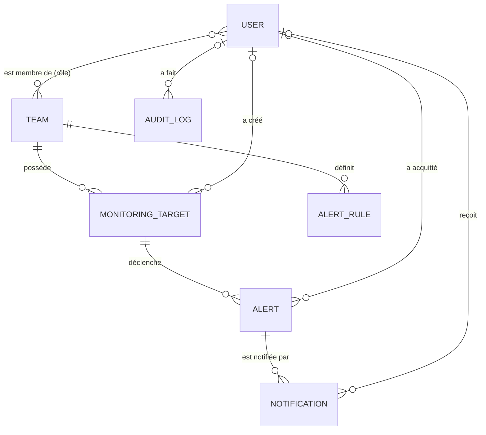
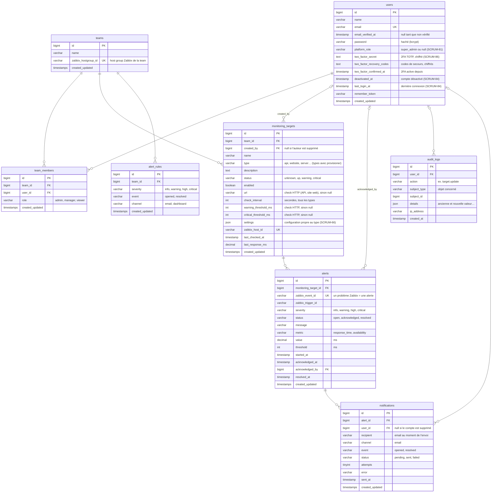

# Modèle de données MySQL (MCD / MLD)

**Objectif :** décrire les données métier stockées par Laravel, leurs liens, leurs clés et leurs index. Les mesures brutes restent dans Zabbix (cahier des charges §38) : Laravel stocke les targets, les alertes, les utilisateurs et l'audit.

**Ticket Jira :** [SCRUM-21](https://wissalshalaoui.atlassian.net/browse/SCRUM-21)

## MCD : les entités et leurs relations

- Un **utilisateur** appartient à une ou plusieurs **teams**, avec un **rôle** dans chacune (Admin, Manager, Viewer).
- Une **target** appartient à une seule team (pas à un utilisateur) ; on garde son auteur pour l'audit.
- Une target déclenche des **alertes** ; une alerte peut être acquittée par un utilisateur.
- Chaque action sensible laisse une ligne dans l'**audit**, qui peut concerner n'importe quel objet (target, alerte…).
- Une team a des **règles de notification** (V1, SCRUM-52) : pour chaque sévérité et chaque événement (ouverture,
  résolution), email ou dashboard seulement. Chaque **notification** envoyée pour une alerte est gardée.

## MLD : les tables

## Clés étrangères et règles de suppression

| Colonne | Référence | Si la ligne référencée est supprimée |
|---|---|---|
| `team_members.team_id` | `teams.id` | les adhésions sont supprimées (cascade) |
| `team_members.user_id` | `users.id` | les adhésions sont supprimées (cascade) |
| `monitoring_targets.team_id` | `teams.id` | les targets sont supprimées (cascade) |
| `monitoring_targets.created_by` | `users.id` | mis à `null` (la target reste) |
| `alerts.monitoring_target_id` | `monitoring_targets.id` | les alertes sont supprimées (cascade) |
| `alerts.acknowledged_by` | `users.id` | mis à `null` (l'alerte reste) |
| `audit_logs.user_id` | `users.id` | mis à `null` (la trace reste) |
| `alert_rules.team_id` | `teams.id` | les règles sont supprimées (cascade) |
| `notifications.alert_id` | `alerts.id` | les notifications sont supprimées (cascade) |
| `notifications.user_id` | `users.id` | mis à `null` ; l'email du destinataire est remplacé par « deleted user » (RGPD) |

## Contraintes d'unicité et index

| Table | Contrainte / index | Pourquoi |
|---|---|---|
| `users` | `email` unique | un compte par adresse |
| `team_members` | (`team_id`, `user_id`) unique | une seule adhésion par personne et par team |
| `teams` | `zabbix_hostgroup_id` unique | une team = un host group Zabbix |
| `monitoring_targets` | `zabbix_host_id` unique | une target = un host Zabbix |
| `monitoring_targets` | index (`team_id`, `status`) | compteurs du dashboard par team et par statut |
| `alerts` | `zabbix_event_id` unique | pas de doublon d'une synchro à l'autre |
| `alerts` | index (`monitoring_target_id`, `status`) | alertes actives d'une target |
| `alerts` | index (`status`, `started_at`) | pages Alertes actives / Historique triées par date |
| `audit_logs` | index (`action`, `created_at`) | recherche dans l'audit par type d'action |
| `audit_logs` | index (`subject_type`, `subject_id`) | historique d'un objet précis |
| `alert_rules` | (`team_id`, `severity`, `event`) unique | une seule règle par sévérité et par événement |
| `notifications` | (`alert_id`, `recipient`, `channel`, `event`) unique | une notification n'est jamais envoyée deux fois pour le même événement |
| `notifications` | index (`status`, `created_at`) | historique des notifications, filtre par statut |

Le nom d'une target est aussi unique **dans sa team** (règle de validation applicative).

## Tables techniques de Laravel

`sessions`, `password_reset_tokens`, `cache`, `cache_locks`, `jobs`, `job_batches` et `failed_jobs` sont créées par Laravel et ne portent pas de données métier.

## Évolutions de la V1

- **`alert_rules`** et **`notifications`** (SCRUM-52) : voir ci-dessus. Règles par défaut de chaque team : CRITICAL et
  HIGH par email à l'ouverture et à la résolution, WARNING et INFO au dashboard seulement.
- **`target_daily_stats`** (SCRUM-51) : statistiques journalières par target (disponibilité, temps de réponse moyen,
  incidents, MTTR), une ligne par target et par jour.
- Grafana : pas de table `grafana_dashboards` (prévue au départ). Un dashboard générique sert pour toutes les targets
  (SCRUM-46) ; les ids de l'organisation Grafana et de l'utilisateur Zabbix d'une team sont dans `teams` (SCRUM-48).
