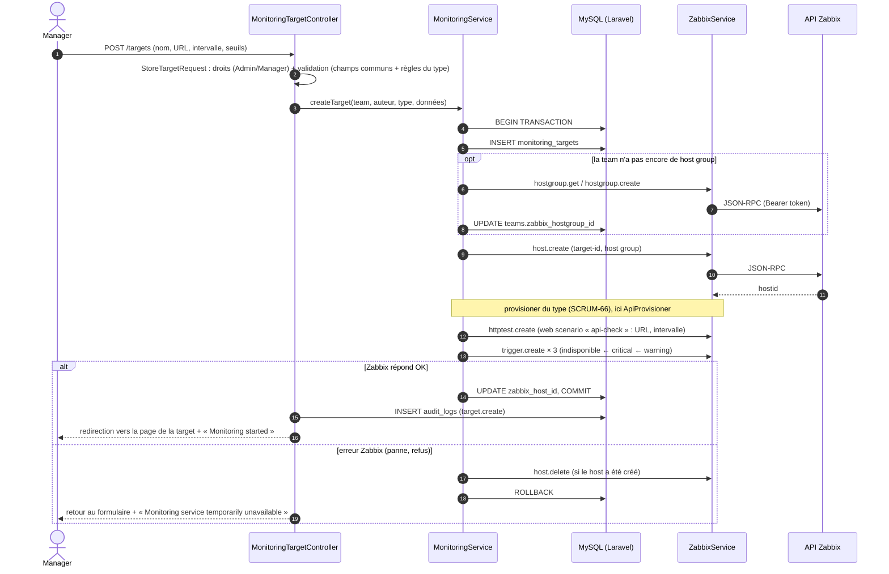
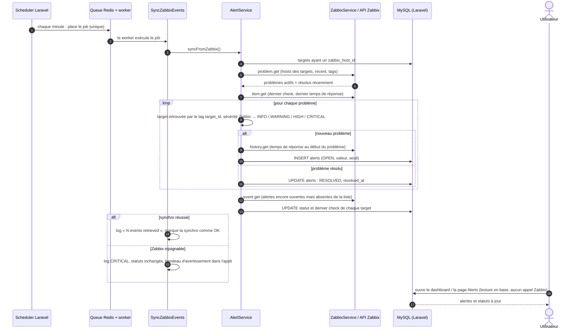

# Diagrammes de séquence des flux critiques

**Objectif :** montrer, étape par étape, comment les composants échangent pendant les deux flux les plus importants : créer une target et transformer un problème Zabbix en alerte.

**Ticket Jira :** [SCRUM-22](https://wissalshalaoui.atlassian.net/browse/SCRUM-22)

## 1. Création d'une target

Un Manager remplit le formulaire « Add Monitoring Target ». Tout se fait **en tout ou rien** : si Zabbix refuse une étape, rien ne reste ni dans la base ni dans Zabbix.

## 2. Synchronisation d'une alerte

Chaque minute, sans intervention humaine, les problèmes détectés par Zabbix deviennent des alertes dans la plateforme.

## Points importants

- **Aucun appel Zabbix au chargement d'une page** : l'utilisateur lit la base, que la synchro tient à jour. Une panne de Zabbix ne casse donc pas l'interface.
- **Pas de doublon** : une alerte est identifiée par l'`eventid` Zabbix ; relancer la synchro ne crée rien de plus.
- **Une seule alerte par incident** : les triggers sont chaînés (indisponible ← critical ← warning), Zabbix ne lève que le plus grave.
