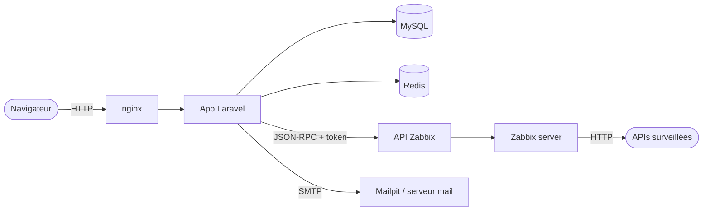

# Modèle de menaces STRIDE et checklist OWASP

**Objectif :** analyser ce qu'un attaquant pourrait faire sur chaque composant, et vérifier quelles protections existent dans le MVP.

**Ticket Jira :** [SCRUM-24](https://wissalshalaoui.atlassian.net/browse/SCRUM-24)

## Rappel STRIDE

| Lettre | Menace | Ce qu'elle viole |
|---|---|---|
| **S** | Spoofing : se faire passer pour quelqu'un | Authentification |
| **T** | Tampering : modifier des données ou des requêtes | Intégrité |
| **R** | Repudiation : nier avoir fait une action | Traçabilité |
| **I** | Information disclosure : accéder à des données interdites | Confidentialité |
| **D** | Denial of service : rendre le service indisponible | Disponibilité |
| **E** | Elevation of privilege : obtenir plus de droits | Autorisation |

## Composants analysés

Frontières de confiance : le navigateur (non fiable) → l'application ; l'application → Zabbix (secret partagé : le token API) ; Zabbix → les URL surveillées (saisies par les utilisateurs).

## Tableau STRIDE

| Composant | Menace | Exemple d'attaque | Contre-mesure | Statut |
|---|---|---|---|---|
| Authentification | **S** | Deviner un mot de passe par force brute | 5 essais / min par email + IP ; mots de passe hachés bcrypt (coût 12), 8 caractères minimum | ✅ |
| Authentification | **S** | Créer un compte avec l'email de quelqu'un d'autre | Vérification d'email obligatoire avant tout accès | ✅ |
| Authentification | **S** | Voler une session | Cookies `HttpOnly` et `SameSite=Lax`, session régénérée à la connexion ; en production : HTTPS obligatoire, HSTS, cookies `Secure` (SCRUM-61) | ✅ |
| Réinitialisation du mot de passe | **S / T** | Réutiliser ou forger un lien | Jeton aléatoire valable 60 min, usage unique ; liens de vérification signés | ✅ |
| Formulaires | **T** | Faire agir un utilisateur connecté à son insu (CSRF) | Jeton CSRF sur tous les formulaires `POST/PUT/DELETE` | ✅ |
| Formulaires | **T** | Injection SQL | Eloquent / requêtes préparées ; recherche `LIKE` échappée | ✅ |
| Pages | **T / I** | Injection de script (XSS) via un nom de target | Échappement automatique Blade (`{{ }}`) | ✅ |
| Targets et alertes | **I** | Voir les targets d'une autre team en changeant l'id dans l'URL | Policies `view/update/delete`, scope `visibleTo`, filtres limités aux targets visibles | ✅ tests Feature |
| Targets et alertes | **E** | Un Viewer qui modifie, supprime ou acquitte | Permissions nommées par rôle (`target.update`, `alert.acknowledge`…), matrice unique dans `TeamRole` ; 403 sinon (SCRUM-58) | ✅ tests Feature (matrice complète) |
| API interne (graphiques) | **I** | Lire les mesures d'une target d'une autre team | Même authentification et policy `view` que les pages | ✅ |
| Appels Zabbix | **I** | Fuite du token API | Token dans `.env` (jamais commité), jamais écrit dans les logs ; token dédié à l'application | ✅ |
| Appels Zabbix | **T** | Saisir une URL interne pour sonder le réseau (SSRF via Zabbix) | URL limitée à `http`/`https` ; règle `PublicUrl` : refus des adresses locales, privées, link-local et réservées (IPv4 et IPv6), contrôlé sur les IP résolues ; liste blanche pour la démo (SCRUM-57) | ✅ |
| Appels Zabbix | **D** | Zabbix lent ou en panne bloque l'appli | Timeout 15 s, nouvelles tentatives sur les lectures seulement ; pages servies depuis la base ; bandeau générique | ✅ |
| Actions sensibles | **R** | Nier avoir supprimé une target ou acquitté une alerte | `audit_logs` : qui, quoi, quand, IP, anciennes et nouvelles valeurs | ✅ |
| Erreurs | **I** | Lire une trace technique (chemins, requêtes) | Messages génériques (§47) ; `APP_DEBUG=false` en production, contrôlé par `php artisan security:check` (SCRUM-61) | ✅ |
| Emails | **S** | Faux emails de réinitialisation (phishing) | Expéditeur unique `noreply@…` ; SPF/DKIM à configurer en production | ⏳ |
| Webhooks (V2) | **S / T** | Appeler un webhook entrant sans y être autorisé | Signature HMAC des webhooks prévue avec la fonctionnalité | ⏳ V2 |
| Base de données | **I / D** | Accès direct à MySQL ou phpMyAdmin | Ports réservés à la machine locale (phpMyAdmin sur `127.0.0.1`) ; non exposés en production : `docker-compose.prod.yml` retire le port MySQL et arrête phpMyAdmin (SCRUM-61) | ✅ (MySQL publié sur `127.0.0.1:3307` en dev seulement) |

## Checklist OWASP Top 10 (2021) appliquée au projet

| Catégorie | Ce qui est en place | Reste à faire |
|---|---|---|
| **A01 Contrôle d'accès défaillant** | Policies Laravel sur chaque action, permissions nommées par rôle (RBAC, SCRUM-58), cloisonnement par team, filtres limités aux données visibles, tests de toute la matrice rôle × action ; gestion des membres et invitations (SCRUM-59) | — |
| **A02 Défaillances cryptographiques** | bcrypt pour les mots de passe, URLs signées, `APP_KEY` secrète ; en production : HTTPS (TLS 1.2 / 1.3), HSTS, cookies `Secure` et session chiffrée (SCRUM-61) | — |
| **A03 Injection** | Requêtes préparées, `LIKE` échappé, validation serveur (FormRequest), échappement Blade | — |
| **A04 Conception non sécurisée** | Analyse STRIDE, création « tout ou rien », aucune page dépendante de Zabbix | Revoir à chaque nouvelle fonctionnalité V1 |
| **A05 Mauvaise configuration de sécurité** | `.env` hors du dépôt, ports de dev limités à la machine locale ; CSP sans script inline, `X-Frame-Options`, `nosniff`, `Referrer-Policy` ; `.env.production.example` (`APP_DEBUG=false`) vérifié par `security:check` ; MySQL non publié en production (SCRUM-61) | Styles inline encore autorisés par la CSP (`'unsafe-inline'` sur `style-src`) |
| **A06 Composants vulnérables** | `composer audit` et `npm audit --audit-level=high` dans la CI ; images Zabbix épinglées sur une version précise ; mises à jour mensuelles documentées (SCRUM-64) | Images encore épinglées sur la version majeure seulement (`phpmyadmin:5`, `redis:7`) : outils de dev |
| **A07 Identification et authentification** | Limitation des tentatives, vérification d'email, réinitialisation sécurisée | 2FA (optionnel, §28) |
| **A08 Intégrité des données et du logiciel** | Une PR par ticket, CI verte avant chaque fusion, synchro idempotente | Protection de branche sur `main` (non disponible sur un dépôt privé gratuit) |
| **A09 Journalisation et surveillance** | Audit des actions sensibles, consultable par l'Admin de la team et purgé après 1 an (SCRUM-60), logs Zabbix dédiés, log CRITICAL si la synchro échoue | Alerte quand la synchro échoue plusieurs fois |
| **A10 SSRF** | URL de target limitée à `http`/`https` ; adresses internes refusées après résolution DNS (SCRUM-57) | Limite connue : un nom dont l'adresse change après la validation (DNS rebinding) n'est pas recontrôlé |

## Conclusion

Le MVP couvre les menaces principales : authentification, cloisonnement entre teams, injections, traçabilité et indisponibilité de Zabbix. La **configuration de production** (HTTPS, en-têtes, `APP_DEBUG=false`, logs) est prête depuis SCRUM-61 ; il reste à configurer SPF/DKIM pour les emails. Le **SSRF**, relevé par cette analyse, est corrigé depuis SCRUM-57 : une target ne peut plus viser une adresse du réseau interne.
