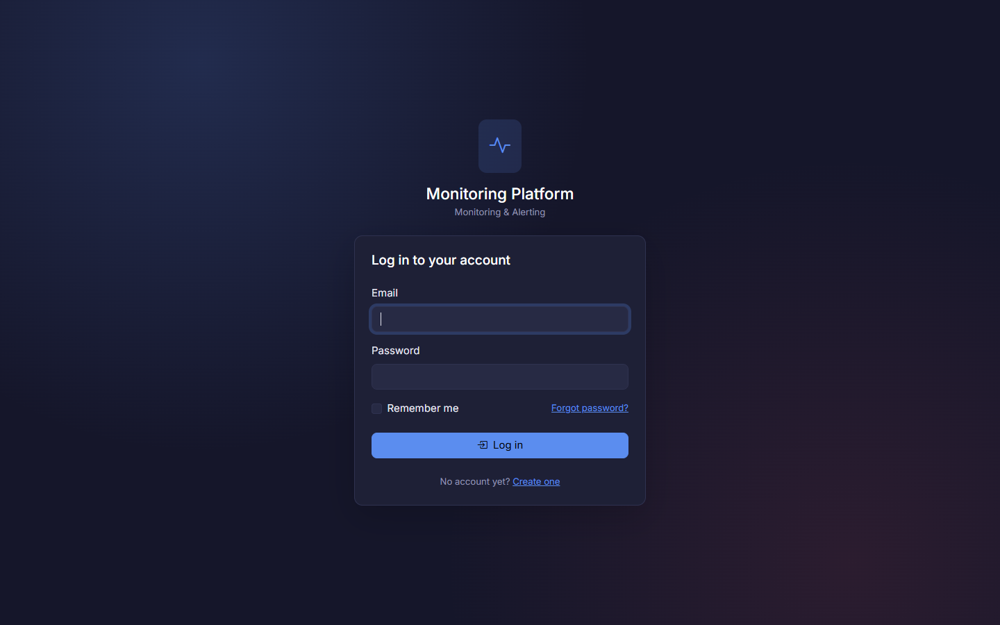
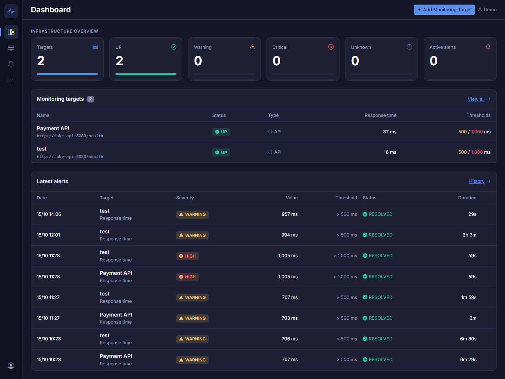
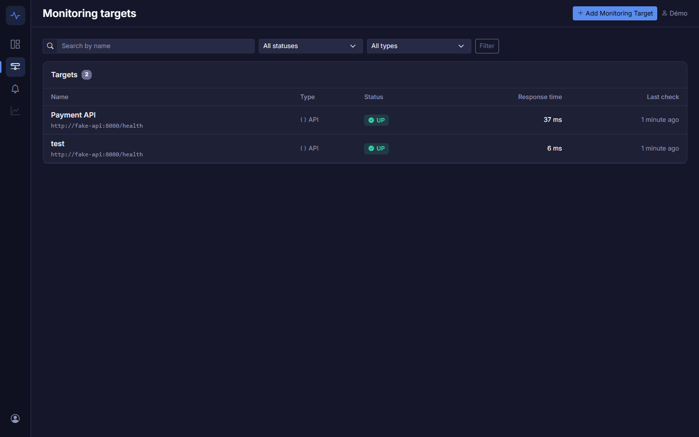
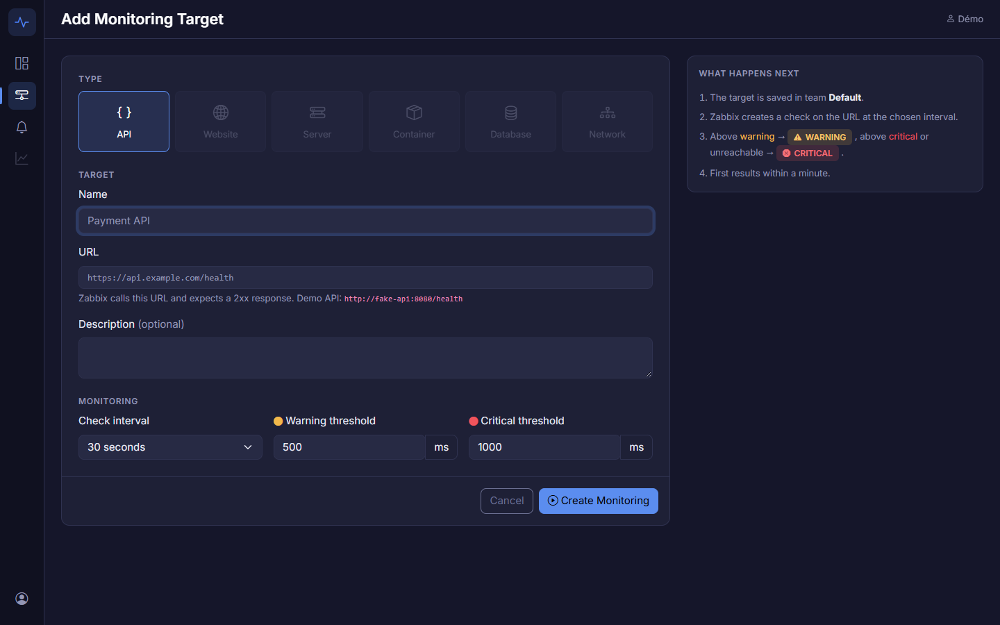
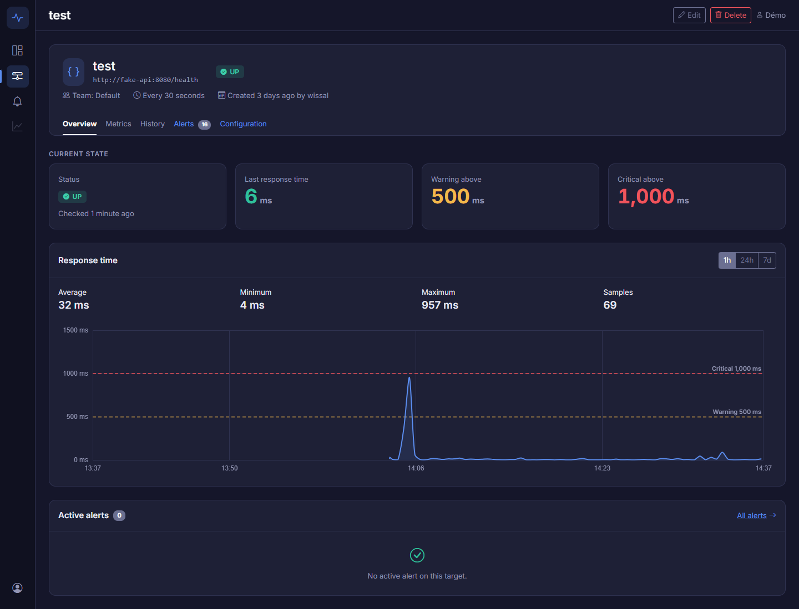
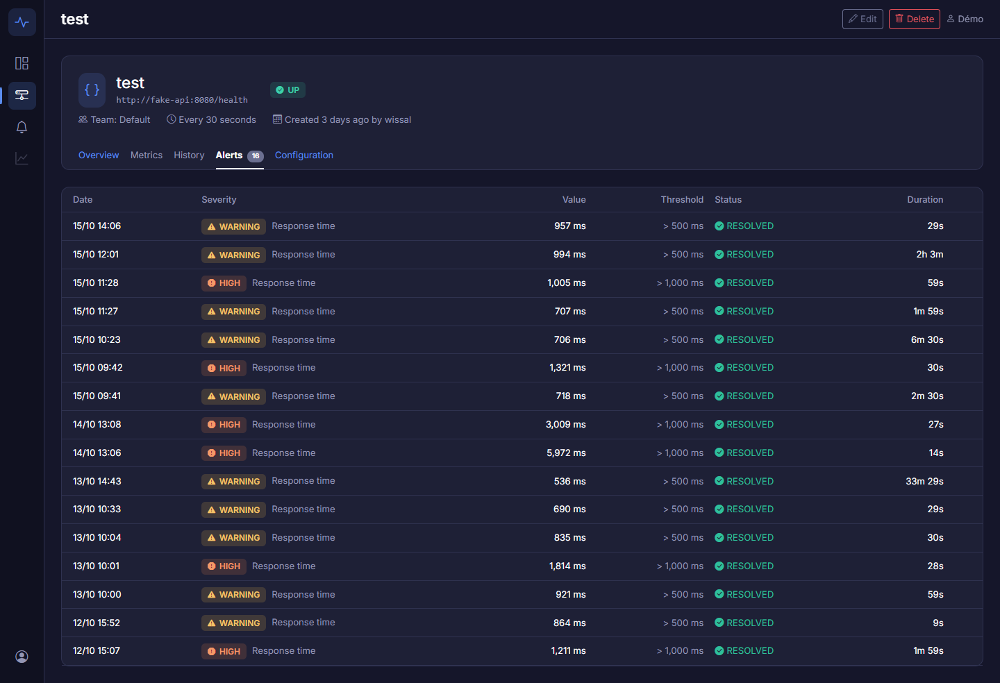
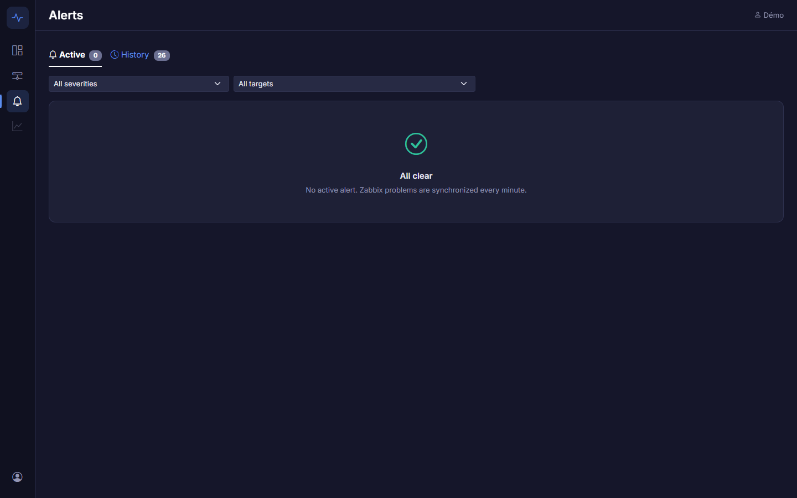
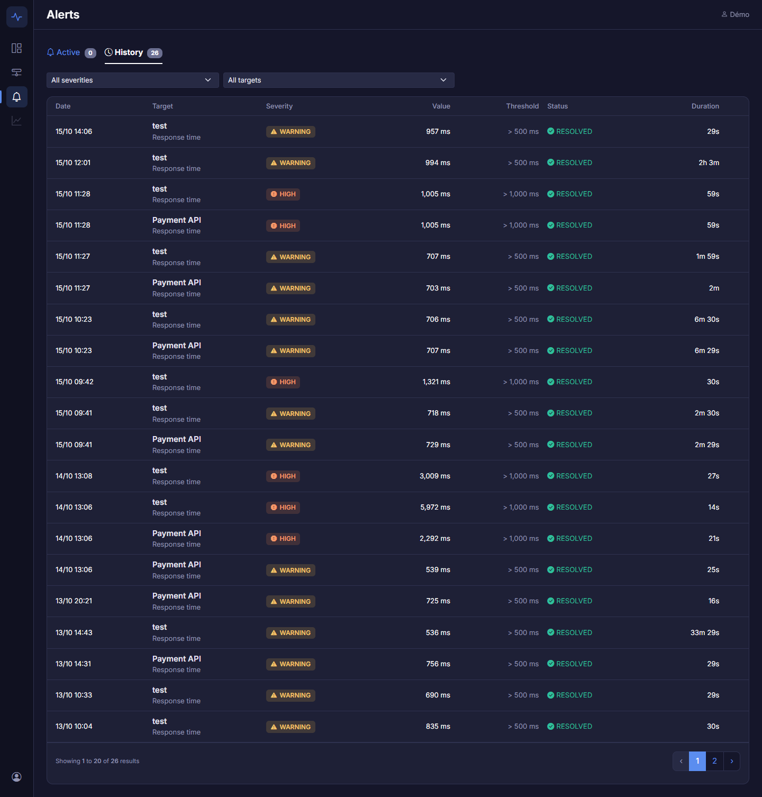

# Écrans du MVP

**Objectif :** montrer les écrans de l'application et expliquer à quoi sert chaque zone. Les écrans ont été conçus directement en Blade + Bootstrap 5 (thème sombre « observability », SCRUM-45) : les maquettes sont donc remplacées par des captures annotées des vrais écrans de la v0.1.0-mvp.

**Ticket Jira :** [SCRUM-23](https://wissalshalaoui.atlassian.net/browse/SCRUM-23)

Repères communs à toutes les pages :

- **Barre latérale à gauche** : Dashboard, Monitoring (targets), Alerts ; Dashboards Grafana grisé (V1) ; menu du compte en bas.
- **Barre du haut** : titre de la page et actions principales (« Add Monitoring Target », Edit, Delete) selon le rôle.
- **Couleurs de statut** : vert = UP / RESOLVED, jaune = WARNING, orange = HIGH, rouge = CRITICAL, gris = UNKNOWN ; chaque badge a aussi une icône et un libellé, la couleur n'est jamais seule.

## 1. Connexion

Email et mot de passe, case « Remember me », lien « Forgot password? » (email de réinitialisation) et lien vers l'inscription. 5 essais par minute au maximum.

## 2. Dashboard

1. **Six cartes KPI** : total des targets, UP, Warning, Critical, Unknown, alertes actives. Chaque carte ouvre la liste filtrée correspondante.
2. **Monitoring targets** : les targets en difficulté apparaissent en premier, avec leur statut, leur dernier temps de réponse et leurs seuils.
3. **Latest alerts** : les 8 alertes les plus récentes, avec leur durée.

## 3. Liste des targets

Recherche par nom, filtres par statut et par type, pagination. Pour chaque target : statut, temps de réponse (coloré selon les seuils) et heure du dernier check.

## 4. Formulaire de création

1. **Type** : seul API est disponible dans le MVP, les autres types sont annoncés.
2. **Target** : nom, URL vérifiée par Zabbix (réponse 2xx attendue), description.
3. **Monitoring** : intervalle de check, seuils warning et critical en millisecondes.
4. **Encadré « What happens next »** : ce que la plateforme va créer dans Zabbix.

Le même formulaire sert à la modification (bouton Edit d'une target).

## 5. Page d'une target : vue d'ensemble

1. **En-tête** : nom, URL, statut, team, intervalle ; boutons Edit et Delete pour les Admin et Manager.
2. **Onglets** : Overview, Alerts, Configuration ; Metrics et History arrivent en V1.
3. **État actuel** : statut et dernier check, dernier temps de réponse, seuils.
4. **Graphique du temps de réponse** : périodes 1h / 24h / 7j, moyenne, minimum, maximum, lignes pointillées des seuils.
5. **Alertes actives** de la target, avec le bouton Acknowledge.

## 6. Page d'une target : onglet Alerts

Toutes les alertes de la target, actives et résolues, avec la valeur mesurée, le seuil dépassé et la durée de l'incident.

## 7. Alertes actives

Onglet Active : alertes OPEN et ACKNOWLEDGED de toutes les targets visibles, filtres par sévérité et par target. Un Admin ou un Manager peut acquitter une alerte OPEN ; l'auteur et l'heure s'affichent ensuite sous le statut. Ici aucune alerte n'est en cours : la page affiche « All clear ».

## 8. Historique des alertes

Onglet History : alertes résolues, les plus récentes en premier, avec la durée de chaque incident ; mêmes filtres, 20 alertes par page.
